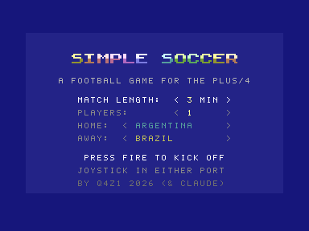
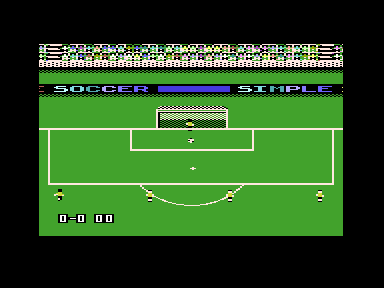

# Simple Soccer for the Commodore Plus/4

A soccer game after **Sensible Soccer** (Sensible Software, 1992-1994,
Amiga), drawn the way **Arlasoft Soccer** draws it on the C64: a ground
larger than the screen that scrolls in eight directions, small players
with their shadows, the stands and the boards around the pitch.

**Work in progress.** What is there: the whole ground, both teams in
their formation, the player of yours nearest the ball, who dribbles it,
passes it and shoots, with aftertouch, the other team going for the
ball, the keepers, sliding tackles, and the rules - throw-ins, goal
kicks, corners, goals and kick-offs, the score and the time; the view
follows the ball.

 

## Controls

| Joystick (either port) | Keyboard | |
| --- | --- | --- |
| directions | cursor keys | run, and dribble the ball at your feet |
| none | | stand - meet a pass, stop a ball that comes to you |
| fire, tapped | space | pass, to the team-mate the way you face; takes a throw-in, corner, goal kick or kick-off |
| fire, the other team on the ball | space | sliding tackle, the way you face |
| fire, held | space | shot - then the stick bends it across, or lifts it pulled back |

## Building and running

```sh
simple-soccer/build.sh       # -> simple-soccer/build/simple-soccer.prg
simple-soccer/run-yape.sh    # in Yape, with the gamepad set up as for Paradroid
simple-soccer/run.sh         # in VICE
```

In VS Code, F5 with any file of the folder open builds and starts it.
`tools/mkdata.py` makes the data the game is built with from the text
files in `data/`.

## How it plays

The match runs on Sensible Soccer's pitch and in its units, 50 times a
second, as Sensible Soccer moves things: a player or the ball always
heads for a point at a speed, the ball rolls and flies with its friction,
gravity and bounce, a dribbled ball is kicked on just ahead of the player
whenever it is at his feet, and a pass goes to the nearest team-mate
within an eighth of a turn of the way you face, harder the further he
is. Fire held for nine frames shoots instead, rising; for the next ten
frames the stick bends the ball to one side if it is pushed across the
shot, and on the fifth it lifts it - high when pulled back, less when let
go or across. The C64 runs its match on the same pitch, in the same
pixels, and so does this game: a pixel of the pitch is a pixel on the
screen, up and down as across - the ground is shown as the C64 shows it,
its plain rows of grass between the boxes and the centre circle, and
beside the goals, repeated (`data/rows.txt`).

For a kick-off the teams line up as on the C64 - the team kicking off
with a forward at the ball, another beside him and its wingers up on the
halfway line, the other team out of the centre circle - and stand till
the ball is played.

Everyone else keeps to his place in the team's formation (`data/tactics.txt`,
eight of them, 4-4-2 for now): each player has an area, and where the ball
is on the pitch decides where in it he stands - he runs there. The yellow
team sends its player nearest the ball after it. A cyan player with the
ball he stays on, a little faster than him, and it is his once it is
right at his feet, nearer him than the cyan player. With it he takes it
towards the cyan goal and shoots from close in - or, a cyan player at
him or after a moment on the ball, passes it on to the team-mate furthest
on, who goes to meet it.
Its next nearest goes along: between the ball and his goal while the
cyan team has it, ahead of it, there to be passed to, while his own does. The joystick
moves to the cyan player nearest the ball; his shirt flickers white, as
on the C64, so you see whom you run. As in Sensible Soccer, the
players make up their minds every second frame; everyone moves every
frame. A new place in the formation does not send a player sprinting: he goes
as fast as gets him there by about when the next one comes, his feet as
fast as he goes, gliding along with the play instead of hopping.

Over a touch line the ball goes to the other team for a throw-in; over a
goal line, between the posts and under the bar, it is a goal and the
other team kicks off; else a goal kick or a corner, by who touched it
last. The ball is dead for a moment first - it rolls on, the net holds it
after a goal - then it is put down with the taker behind it. When it is
the cyan team's, the stick turns him and fire takes it (a pass, or held,
a shot); the yellow team passes to the nearest team-mate.

A throw-in is thrown: the taker stands behind the touch line facing the
pitch, the ball held up behind his head, and throws it with his arms
going forward - the ball leaving his hands from up there and dropping
in a short curve. Its two pictures, each way, are drawn for this game,
not the C64's.

A pass takes the joystick to the player it goes to; with the stick let
go he runs to meet it, and stops a ball that comes to his feet.

A ball is a team's while its player who touched it last has it by him,
or for a few frames after a kick: the other team cannot just run it
off him. You win it with a sliding tackle - fire - which knocks it on
the way you slide; the yellow chaser wins it by getting to it first.

The TED's two voices give the match its sounds, played by the interrupt
50 times a second: a thump for every pass and shot, a softer one for
the keeper's catch, the referee's whistle - a trill - at a kick-off,
three blasts at half and full time, and the crowd roaring at a goal.

A title comes first: the name, the length of the match to choose with
the stick (3, 5 or 7 minutes), fire to kick off. It is loaded where the
pictures go once the match is on, and runs before them.

A match is 90 minutes in three real ones (or five, or seven). At 45 the referee blows for
half time, the teams change ends and the yellow team kicks off; at 90 the result stays
till fire starts a new match. While the ball is dead for a kick-off -
after a goal, at half time, at the start - the score and the minute
show at the top left of the view.

A keeper stands between his posts a little out from his line, further
out the further the ball, and goes a quarter of the ball's way across.
A ball coming at his goal sends him, faster, to where it will cross his
line - late, as in Sensible Soccer, once it is close: a hard shot into a
corner beats him, a slow one he gets to. One within his reach he catches
- unless it is higher than he gets, a lob - and kicks out like a set
piece.

## How it is drawn

The Plus/4 has no sprites, so a player is drawn into the characters under
him. There are three pictures, each with a colour matrix, a code matrix
and a character set of its own: one is shown, a finished one may be
waiting, and the third is being drawn. The interrupt puts the waiting one
on screen in the vertical blank, with the fine scroll it was drawn for,
never sooner than three frames after the last - an even 16.7 pictures a
second (`PACE=2 simple-soccer/build.sh` for 25, which a full screen of players
cannot keep up). A picture that costs more than three frames to draw
borrows the time from the cheaper one before it. The match itself runs
50 times a second whatever the pictures do.

When the view has moved by a cell or two since a picture was last drawn,
its codes are not looked up afresh but moved over in memory, and only the
rows and columns coming in are looked up.

The ground is 79 x 103 cells (67 different rows) of 221 different characters - too many to sit
in a character set next to the players'. But a screen never shows more
than 76 of them, so each picture's set holds only those it shows, given
codes as they are first met while the picture is built; the codes from
112 on are the players'. A column of a player gets as many of those as it
covers cells, one after the other, so that their pixels lie one after
the other in the character set: the column goes into that strip in one
run. Over grass its pixels go straight in; where a line or another
player is under it, that is copied into the strip first and the player
goes in through a mask. Each picture keeps a list of the cells its
players took, with what they showed before, and puts them back before
it is drawn again. A cache that fills up gives back the codes its
picture does not show - found in one pass over its codes - before it
runs full, and never for two pictures running.

The C64 has two colours for a sprite besides its own; a multicolour
character on the TED shares three with the whole screen and has one of
its own. The shared ones are the grass, black, and one light colour -
the lightest red, near white - that is the lines, the nets, the ball
and the players' skin at once. A cell's own colour is a player's shirt
where he has a bit of shirt in it; with nothing on the pitch in that
colour, a player can take any cell and nothing under him changes. (Two
players of different teams in one cell: the one behind loses his shirt
there.) The socks are black, and neither the players nor the goals cast
a shadow.

Where the TED does more than the C64, the game uses it: a cell's own
colour can be any of eight hues in eight shades, so every spectator in
the stands wears a shirt of his own instead of the C64's white, and the
boards along the pitch show the name in letters two cells wide - the
C64's one-cell letters cannot make an M - each in a colour of a sweep
from yellow to red or cyan to blue, on black. Those cells get their
colours from a map of the rows that have them, put in again only when
the view has moved. Now and then a wave runs through the stands: the
spectators of one kind after another raised a pixel - they sit side by
side in that order, so the raise runs along the rows (the characters
in each picture's cache rewritten, whatever codes they have there).




It is a fan-made proof of concept, not affiliated with or endorsed by
Sensible Software or Arlasoft.
