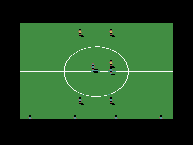
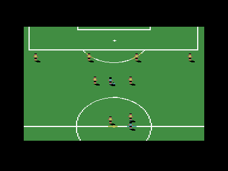

# Simple Soccer for the Commodore Plus/4

A soccer game after **Sensible Soccer** (Sensible Software, 1992-1994,
Amiga), drawn the way **Arlasoft Soccer** draws it on the C64: a ground
larger than the screen that scrolls in eight directions, small players
with their shadows, the stands and the boards around the pitch.

**Work in progress.** What is there: the whole ground, both teams in
their formation, the player of yours nearest the ball, who dribbles it,
passes it and shoots, with aftertouch, the other team going for the
ball, and the rules - throw-ins, goal kicks, corners, goals and
kick-offs; the view follows the ball. Still to come: the keepers,
tackles, the score on screen, the time.



## Controls

| Joystick (either port) | Keyboard | |
| --- | --- | --- |
| directions | cursor keys | run, and dribble the ball at your feet |
| fire, tapped | space | pass, to the team-mate the way you face; takes a throw-in, corner, goal kick or kick-off |
| fire, held | space | shot - then the stick bends it across, or lifts it pulled back |

## Building and running

```sh
simple-soccer/build.sh       # -> simple-soccer/build/simple-soccer.prg
simple-soccer/run-yape.sh    # in Yape, with the gamepad set up as for Paradroid
simple-soccer/run.sh         # in VICE
```

In VS Code, F5 with any file of the folder open builds and starts it.
`tools/mkdata.py` makes the data the game is built with from the text
files in `data/`.

## How it plays

The match runs on Sensible Soccer's pitch and in its units, 50 times a
second, as Sensible Soccer moves things: a player or the ball always
heads for a point at a speed, the ball rolls and flies with its friction,
gravity and bounce, a dribbled ball is kicked on just ahead of the player
whenever it is at his feet, and a pass goes to the nearest team-mate
within an eighth of a turn of the way you face, harder the further he
is. Fire held for nine frames shoots instead, rising; for the next ten
frames the stick bends the ball to one side if it is pushed across the
shot, and on the fifth it lifts it - high when pulled back, less when let
go or across. The ground the C64 draws is shorter than Sensible Soccer's pitch, so
the game's lengths are squeezed onto it: across one to one, along by
about nine sixteenths.

Everyone else keeps to his place in the team's formation (`data/tactics.txt`,
eight of them, 4-4-2 for now): each player has an area, and where the ball
is on the pitch decides where in it he stands - he runs there. The yellow
team sends its player nearest the ball after it; with it at his feet he
takes it towards the cyan goal and shoots from close in. The joystick
moves to the cyan player nearest the ball. As in Sensible Soccer, the
players make up their minds every second frame; the ball and the two at
it move every frame, the others once for each picture, by all the frames
since the last.

Over a touch line the ball goes to the other team for a throw-in; over a
goal line, between the posts and under the bar, it is a goal and the
other team kicks off; else a goal kick or a corner, by who touched it
last. The ball is dead for a moment first - it rolls on, the net holds it
after a goal - then it is put down with the taker behind it. When it is
the cyan team's, the stick turns him and fire takes it (a pass, or held,
a shot); the yellow team passes to the nearest team-mate.

## How it is drawn

The Plus/4 has no sprites, so a player is drawn into the characters under
him. There are three pictures, each with a colour matrix, a code matrix
and a character set of its own: one is shown, a finished one may be
waiting, and the third is being drawn. The interrupt puts the waiting one
on screen in the vertical blank, with the fine scroll it was drawn for,
never sooner than three frames after the last - an even 16.7 pictures a
second (`PACE=2 simple-soccer/build.sh` for 25, which a full screen of players
cannot keep up). A picture that costs more than three frames to draw
borrows the time from the cheaper one before it. The match itself runs
50 times a second whatever the pictures do.

When the view has moved by a cell or two since a picture was last drawn,
its codes are not looked up afresh but moved over in memory, and only the
rows and columns coming in are looked up.

The ground is 79 x 67 cells of 221 different characters - too many to sit
in a character set next to the players'. But a screen never shows more
than 76 of them, so each picture's set holds only those it shows, given
codes as they are first met while the picture is built; the codes from
112 on are the players'. A column of a player gets as many of those as it
covers cells, one after the other, so that their pixels lie one after
the other in the character set: the column goes into that strip in one
run. Over grass its pixels go straight in; where a line or another
player is under it, that is copied into the strip first and the player
goes in through a mask. Each picture keeps a list of the cells its
players took, with what they showed before, and puts them back before
it is drawn again. A cache that fills up gives back the codes its
picture does not show - found in one pass over its codes - before it
runs full, and never for two pictures running.

The C64 has two colours for a sprite besides its own; a multicolour
character on the TED shares three with the whole screen and has one of
its own. The grass, black and the players' skin are the shared ones, and
a cell's own colour is white, for the lines and the nets - or the shirt
of a player in it. Only the cells with a bit of shirt in them take its
colour - the shirt alone, the socks are black, so the cells at a
player's feet stay white for the lines and the ball - and what was
white in them turns black instead of to the shirt's colour: in front of
the net it passes for its shade. The ball is drawn last and keeps its
cells white. A player's shadow is half its height, and cut where it
would need a column of characters of its own.



It is a fan-made proof of concept, not affiliated with or endorsed by
Sensible Software or Arlasoft.
