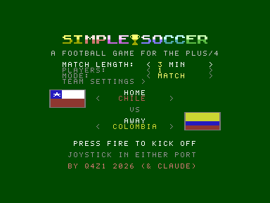
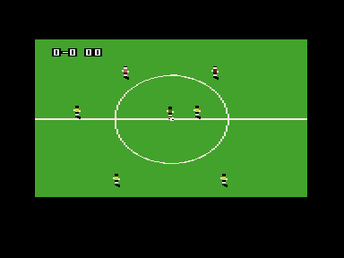
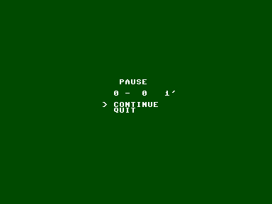
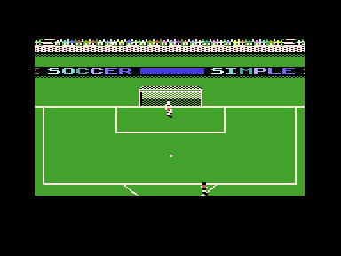
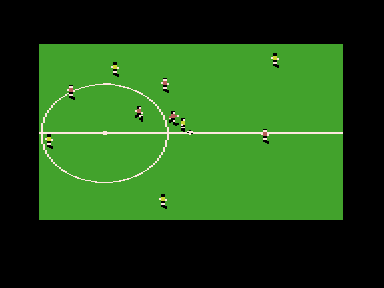

# Simple Soccer for the Commodore Plus/4

A soccer game after **Sensible Soccer** (Sensible Software, 1992-1994,
Amiga), drawn the way **Arlasoft Soccer** draws it on the C64: a ground
larger than the screen that scrolls in eight directions, small players
with their shadows, the stands and the boards around the pitch.

**Work in progress.** What is there: the whole ground, both teams in
their formation, the player of yours nearest the ball, who dribbles it,
passes it and shoots, with aftertouch, the other team going for the
ball, the keepers, sliding tackles, headers, and the rules - throw-ins,
goal kicks, corners, fouls with free kicks and penalties, goals and
kick-offs, the score and the time; the view
follows the ball. One player against the computer, or two against each
other, with 39 national teams from all over the world to choose from -
a match, training (a keeper and four a side, to try the moves out), or a
league of eight teams for one player or two, kept on the disk. A match
can be paused (RUN/STOP), left, and saved on the disk to go on with
later. How the ball is kept, thrown in and crossed from a corner is
measured on the C64's Arlasoft Soccer: it is the game this one should
feel like.

 

The trailer, every move in training: [Simple Soccer - The Moves](https://www.youtube.com/watch?v=ZKL9SXwIObI)
on YouTube (made by `tests/trailer.py`).

## Controls

| Joystick (either port) | Keyboard | |
| --- | --- | --- |
| directions | cursor keys | run, and dribble the ball at your feet |
| none | | stand - a ball that comes to you runs on past you |
| fire, tapped | space | pass, to the team-mate the way you face; takes a throw-in, corner, goal kick or kick-off |
| at your throw-in or corner: each push of a direction | cursor keys | turns the aim (two dots) a step towards it |
| fire and a direction, the ball low and near you | space and a cursor key | sliding tackle, that way |
| fire, held | space | shot, at once - held on, the harder; pulled back meanwhile, the higher; the stick across bends it |
| fire, a ball at head height near you | space | header, the stick's way (let go: towards the goal) |
| fire and a direction, the ball 8 - 15 high near you | space and a cursor key | diving header, that way (higher: he jumps and heads it that way) |
| | RUN/STOP or P | pause |
| in the pause: up, down, fire let go | cursor keys, space (RUN/STOP, P: on) | CONTINUE, or QUIT the match |

The pause is on the keys only: in the match the joystick is the play's.
The match stops, the sound with it, and a page shows the score and the
minute. QUIT asks "SAVE THE MATCH?" (RUN/STOP or P: back into it): NO
first, as CONTINUE before QUIT - fire straight away takes what can be
taken back (Luca). NO goes back to the title - a league's match to the league's page, not
played: it is still to play. YES saves the match on the disk first (the
file "match": one at a time, a newer save takes its place), then the
title offers CONTINUE: it goes on with the match as it was - a league's
match counts in the league once it is played out. A league going on
waits meanwhile; CONTINUE takes the saved match first. With CONTINUE
chosen the title shows no teams and no TEAM SETTINGS: the match is the
saved one or the league's next, not the title's to choose.

With one player the joystick in either port (or the keyboard) runs the
home team. With two, the joystick used last on the title runs the home
team (with the keyboard) and the other the away team, each the same
way - the title says "PLAYER 1" and "PLAYER 2" over them then, and below
"HOME: PORT 1   AWAY: PORT 2" or the other way about: whoever played
alone with his joystick in port 2 keeps the home team when a friend
joins (Luca found port 1 always the home team's the wrong way about).
`tests/ports.py` checks it on the title in Yape. (The code and the
rest of this text call them the cyan and the yellow team, the colours
they had before there was a choice.)

## Building and running

```sh
simple-soccer/build.sh       # -> simple-soccer/build/simple-soccer.d64 (and .prg, the game alone)
simple-soccer/run-yape.sh    # in Yape, with the gamepad set up as for Paradroid
simple-soccer/run.sh         # in VICE
```

In VS Code, F5 with any file of the folder open builds and starts it.
`tools/mkdata.py` makes the data the game is built with from the text
files in `data/`.

## The disk

The game comes on a disk, `simple-soccer.d64`: `LOAD"*",8,1` and `RUN`
(or `LOAD"SIMPLE SOCCER",8`). The first program, the boot (`boot.s`),
puts up its loading screen at once - the name as the title shows it, in
the same place, a football turning, and "LOADING" with its dots swelling and fading in the name's colours - and keeps it going while it loads the
flags and the game, and while it unpacks the game (packed by ZX0,
Einar Saukas' compressor - `tools/zx0`, built by `build.sh` - 28 KB on the
disk, 50 KB in memory, loaded high and unpacked over itself by
`unzx0.inc`, a decompressor for the 6502 written for this game: the
game's 15000 blocks are short, so each costs as little as it can - in
some 6 seconds with the music on, where exomizer's took 10 - and with
the fast loader it unpacks while the game loads: the loader and the
unpacking take turns, each on its own stack, the unpacking going on while
the drive reads the next sector). The boot is
packed by exomizer - the machine's own loading, which brings it, is slow:
12 blocks rather than 15 - and the flags, the league's pages and the
title are exomizer's "raw" files, unpacked by the boot and `cup.s`
(`unpack.inc`, the decruncher as trainschedule's): they load to $C000 and
unpack from there, the title over itself. Packing the game takes ZX0 over
a minute: `build.sh` packs it again only when it has changed, and
`ZX0_QUICK=1 ./build.sh` packs it in seconds, a kilobyte bigger, for a
disk only tried out. On a 1541 (any of them),
1570 or 1571 it loads with the fast loader taken over from trainschedule
(`drive.s`, `fastload.s`), and the title's music starts before the
title: the boot loads the music's player first (the file `music`) and
plays it through the last part of the loading - the
last 50 blocks of the game, some 19 seconds before the title (Luca's idea:
the music takes most of the machine, so the loading goes at full speed
till then, and the music brings the player back) - and the title goes on
with the song where it is, on the beat: while the title is drawn, its
interrupt counts the frames itself, as the boot's does, till the title's
loop takes over (before, the notes stood still for a few frames there -
the stumble Luca heard after the loading). On any other drive - a 1551, an
SD2IEC - it loads the KERNAL's way, the screen the same, without the
music till the title: the KERNAL's loading would choke on an interrupt
5542 times a second.

The music takes most of the machine while it plays, so the fast loader
here waits by the clock: its waits are timed with the TED's timer 2
instead of counted in cycles, so an interrupt in the middle of one uses
it up instead of making it longer, and its bits are taken as tightly as
the drive allows. With all that a 1541 brings up the title after some
52 seconds in VICE (a 1551 after 35); the files lie further apart on the
disk to match (`build.sh`, `tests/loadtime.py`). The border turns red while a
file will not load (no disk, a bad one); it tries again by itself.

The ball is worked out by `tools/mkspinner.py`: a sphere with the twelve
black pentagons of a football round the corners of an icosahedron,
turning about the middle of a white hexagon, ten pictures of 24 x 24
pixels. No pentagon lies on the axis, so every one of them moves (about a
pentagon, the one on the axis would only turn on its spot); a third of a
turn brings a football back to how it was, so they go round without a
jump.

The title shows the two teams' flags framed, the home one on the left, the
away one lower down on the right, "VS" between them and each team's name
beside its own (`data/flags.txt`, read by `tools/mkflags.py`). A flag is
6 x 3 multicolour cells, 24 x 24 multicolour pixels, 48 x 24 on the
screen, drawn pixel for pixel after each flag's official construction
sheet: stripes and crosses to their measures, the emblems - stars, suns,
the Union Jack, Canada's leaf, Korea's taegeuk and trigrams, the arms of
Portugal, Mexico and Croatia - at their own size, as far as pixels twice
as wide as high go (Spain's stripes only: its arms will not go small). A cell has four colours - the title's
background, a dark green that is the flags' dark green (the frame keeps
it from the background), white and a second shared colour, and one of its
own - and every flag keeps to that, so each comes out to the pixel. The
second shared colour is red, unless another lets more of the flag come
out: Sweden's, Senegal's, Brazil's, Ukraine's and Uruguay's is yellow, Colombia's
navy, Ghana's black (its star). Brazil's and Portugal's greens are the
dark green: their green, yellow, blue, white (and Portugal's red) would
not go into the cells otherwise. The two flags share no line of the
picture, so the title sets that colour for each while it is drawn (in
the border at the end of a line, where the TED shows no stray pixel for
it). No colour shows that is not in the flag.

The patterns of all the flags' cells are on the disk once each (169 of
them, each only with the rows that are not the one above again - some 5
bytes rather than 8); the title copies those of the two flags shown into
the character codes its own font leaves free. Each side has two sets of codes: a flag
chosen is made ready in the set not on the screen, and only its 18
cells change over, below the picture's last line - a flag is never seen
half drawn, and the screen is multicolour throughout (the name's
colours too are ones a multicolour screen leaves to text). A team cannot
play itself: choosing passes the other side's team by.

## How it plays

The match runs on Sensible Soccer's pitch and in its units, 50 times a
second, as Sensible Soccer moves things: a player or the ball always
heads for a point at a speed, the ball rolls and flies with its friction,
gravity and bounce, a dribbled ball is kicked on just ahead of the player
whenever it is at his feet (going up, beside his right foot, where he
does not hide it) - as the C64's Arlasoft Soccer kicks it, at his own
pace and, every other touch, a push more by how good he is (130 for the
weakest, down to 32 for the best), a little more with the ball behind
him: it stays close, and he keeps it through his turns (running, the
player heads for a point 128 pixels the way the stick points, set anew
each frame - 1000 pixels on, as before, the walls round the pitch cut it
and turned a diagonal run some 11 degrees off the ball's, which was soon
out of reach: no diagonal kept it, said Luca) - and a pass goes to a team-mate, harder the
further he is and the better the kicker, as Arlasoft Soccer passes (3
pixels a frame under 50 pixels, a step each 50 up to 4 from 250, and up
to 0.75 more for the best players - Luca found the shortest too short
to leave the kicker behind): the nearest within 22.5 degrees of the way you face -
unless one up to 67.5 degrees off it is under seven tenths as far; only
with no one in either does it run on by itself, at 2048 (4 pixels a
frame: the originals' 1792 left it too near its kicker, said Luca). Fire let go before the ball has
come to you passes it as it comes, first time - the way you faced while
fire was held (with the stick let go he turns to meet the ball, and the
pass went back where it came from), and while a pass to you is on its
way it waits for it however long it takes. Fire pressed as a pass comes
to you, or as your own dribbled ball is a few pixels ahead, is never a
sliding tackle - it was, and the pass on was lost; Luca found the
passes worked fifty-fifty. `tests/passing.py` taps fire in each of
twelve frames of a dribble and of a pass coming in, a picture or two
long: 48 of 48 reach the team-mate (19 before), and as many the eight
ways across the pitch. Fire pressed with the stick let go - easily done
with a joystick - left the dribbler standing while the ball rolled on
out of his reach, and the pass waited for it in vain (Luca: three
passes in ten the ball stays glued to the foot; `tests/taps.py` taps
fire at random in a match, the ball at the joystick's player's feet,
and found it). Now, the ball his and fire held for a pass or a shot, or
a pass waiting, he goes after it with the stick let go, and the waiting
pass does not run out meanwhile: `tests/passing.py letgo`, 24 of 24 (0
before). As in Sensible Soccer,
fire is acted on every second frame, as it was the frame before - a
pass, a slide or a header comes one or two frames after fire is let go
or pressed, a shot nine or ten after it is pressed (measured in it). Fire held for nine frames shoots instead, at once, rising
1.44 a frame - over the players' heads (13) from some 14 frames on to
27, its top 14.7 under the bar (at Sensible Soccer's 1.25 it was never
above 11, and anyone in its way took it: Luca found every shot blocked;
a ball as fast as a shot, 1536 on, your player now takes only at his
feet, 6 high at most; a set piece's kick and a throw-in rise 1.25 as
before - at 1.44 the long ones came down into the other team's heads) -
at 1792, up to 192 more for the best players - and, unlike both
originals, whose shots are all as hard (2208), fire held on after it
went makes it harder, 32 a frame for up to 24 frames (2560), and with
the stick pulled back meanwhile higher too: let go early, a low shot,
held long and pulled back, a high one - a goal kick, the keeper's kick
and a corner high unless the stick pushes on (Luca: the goal kick was
always intercepted; `tests/restarts.py` takes each set piece with fire
tapped and held and says who gets to it first) (Luca's wish: the game is to know
it is a shot as soon as fire is held so long, not when it is let go, and
the shot to be as hard and high as fire held on). A ball up in the air
always falls: the rise from fire held on and gravity once left a shot's
upward step at exactly 0, which the game took for a ball lying - it flew
on at one height till someone touched it (Luca: height-locked). A throw-in held so
goes 512 slower and takes on half as much - a short one or a long one,
some 1600 at most. For the next ten frames the stick bends the ball to
one side if it is pushed across the shot. The computer shoots as
Sensible Soccer's: at 2208 and its level's more, lifted on the fifth
frame - high when the stick is pulled back, less when let go or across
(for a while the aftertouch did so to a player's shots and throw-ins
too: it set a throw-in to a shot's 2560 - the throw-ins Luca found super
powerful still). `tests/power.py` holds fire so long and measures, the
stick pulled back too, a tap just after a shot (it was swallowed - fire
was taken as still held), a throw-in held long, and what the receiver
of a throw-in does: he no longer heads a throw-in of his own team
untouched since of himself (a double shot, said Luca).

Fire is seen each frame: the interrupt notes it pressed, the next turn
takes it as pressed even if it is let go again by then - the joystick is
read once a picture, three frames, and a tap between two readings was
lost (the ball stayed glued, said Luca). The C64 runs its match on the same pitch, in the same
pixels, and so does this game: a pixel of the pitch is a pixel on the
screen, up and down as across - the ground is shown as the C64 shows it,
its plain rows of grass between the boxes and the centre circle, and
beside the goals, repeated (`data/rows.txt`).

For a kick-off the teams line up as on the C64 - the team kicking off
with a forward at the ball, another beside him and its wingers up on the
halfway line, the other team out of the centre circle - and stand till
the ball is played.

Everyone else keeps to his place in the team's formation (`data/tactics.txt`:
Sensible Soccer's 4-4-2, 5-4-1, 4-5-1, 5-3-2, 3-5-2, 4-3-3, attack,
defend, and two of ours Luca asked for, made of their lines: 3-4-3 - the
back three of 3-5-2, the middle four of 4-4-2, the front three of 4-3-3 -
and 3-3-4, the back three of 3-5-2, the middle three of 4-3-3, 4-4-2's two
forwards and two wingers as wide as 4-3-3's wide men and as far up as
its forwards; each team's chosen on the title, or one at random): each player has an area, and where
the ball is on the pitch decides where in it he stands - he runs there.
The line-up for a kick-off is 4-4-2's whatever the formation.

The computer plays the yellow team as Sensible Soccer's does (c14a4e):
with a joystick of its own for its joystick's player, everything else -
who has the joystick, the one running to the ball, the dribble, passes,
shots, the aftertouch - as for a player's team. Every frame it works
his stick out. Without the ball he runs to it, turning to it only now
and then, unless it is near. With it: near the goal (170 pixels, 1 in
4 beyond 113) and facing it, a shot, bent with the aftertouch towards
the side of the goal he faces; a cyan player at him (28 pixels), far
from the goal, a long ball, else a pass if the player nearest that way
is a team-mate - else, now and then, a step aside while he looks for
one; a cyan player coming (70 pixels), seldom a long ball, 1 in 4 a
pass that way; otherwise on towards the goal. After a pass or a shot
it waits 15 frames, and 13 after any of its team's. Its runner slides
in as Sensible Soccer's computer team's does (c154a8): the ball low and
within 14 pixels of him (but not at his feet), your player within 56
pixels of it, and not facing his way or within 45 degrees of it - so
its fouls come as yours do; and only for a ball your team played last
(he slid for his own team's passes coming to him, down for nothing,
said Luca).

As in Sensible Soccer and on the C64, the cyan player nearest a ball no
one has - not yours, not the keeper - runs to it on his own, as a pass's
receiver does to meet it; a ball the other team has is left to the
player you run, as on the C64 (the computer's runner still goes for it,
to slide in). The joystick stays with the player
who has the ball at his feet, goes to the one running to it once he
gets to it, and else to the player nearest it - not the one on his way to it, not
the one who has just passed or shot. Your player's shirt flickers a
shade lighter or darker, so you see whom you run - and still see whose
he is. As in Sensible Soccer, the
players at the ball make up their minds every second frame, the two
teams by turns - so two players at the ball touch it by turns, either
may come away with it. Each player in the formation gets his place anew
every 11th frame, as there, and goes to it as fast as his team goes,
his feet as fast as he goes.

The ball, the two players the joysticks run and the keepers move every
frame, and every touch of the ball is looked for every frame. The
others, the teams' minds and the computer's joystick go once a picture,
for the frames since the last: each runs as far as those frames take
him, the formation's places and the runners to the ball are worked out
for them, and what Sensible Soccer's computer does at random each frame
it does as often for them. As the C64 does, which moves its players a
picture's way at a time - on the Plus/4 the match would else take more
time than the drawing.

Over a touch line the ball goes to the other team for a throw-in; over a
goal line, between the posts (the ball's middle on them at most, as
they are drawn - the left one let a ball 6 pixels past it in, said
Luca) and under the bar, it is a goal and the
other team kicks off; else a goal kick or a corner, by who touched it
last. The ball is dead for a moment first - it rolls on, the net holds it
after a goal - then it is put down with the taker behind it. Meanwhile
both teams go to their places for it, as Sensible Soccer has them for
each kind of set piece and each shirt, the team taking it and the other:
for a goal kick from either side of the goal area, the keeper's ball, a
corner either side, a free kick in one of seven columns in the band before
the goal attacked (the other team's four nearest the goal then a wall
some 55 pixels from the ball, between it and the goal), a penalty, and a
throw-in in one of three bands along either touch line (three or four of
its team near the taker). Where it has no place for a player - a free
kick elsewhere, the other team at a throw-in - he goes to his place in
the formation for where it is taken, kept 40 pixels from the ball on the
side of his own goal if he is the other team's. Whoever is
still in the way when the ball is put down is put out of it (your
joystick's player too: he stands where he is put while the other team's
set piece waits, and keeps the stick till it is taken - before, the
stick went to whoever came nearest, and he stopped where it took him,
in the wall's way; and anyone put out to 433-511 pixels down the pitch
landed at 433, right behind the taker: Luca; `tests/fkjoy.py`), but at a
goal kick and when a keeper has caught it the other team runs out of
the box, its joystick's player too, and the ball is kicked out only once
the box is clear - put out of it at once, the attacker beside the keeper
just vanished (Luca). Else the other team's joystick's player stands
where he is till the ball moves. If the computer finds no one to
pass to, it kicks the ball after 150 frames. When it is
the cyan team's, the stick turns him and fire takes it (a pass, or held,
a shot) - a goal kick's or the keeper's pass to the team-mate within 34
degrees of the way he faces first, only then within 67.5 (with the wide
cone alone it went to the same man ahead whichever way he faced, said
Luca). At your throw-in, goal kick and keeper's ball a team-mate offers
himself (Luca's idea): look one way for 40 frames - the aim, or the way
the keeper faces - and the team-mate that way (as a pass would choose
him) comes to 62 pixels from the ball and waits; a tap passes to him.
Look another way and he goes back to his place, and after 40 frames the
next comes. Push the stick back - out of the pitch at a throw-in (left
on the left line, right on the right), at your own goal at the keeper's
- and he goes back, no one comes till you push the stick again, any way,
the way the keeper still looks too (it only came for the other two at
first), the aim stays as it was (Luca: a way to have no one offered).
No one comes, either, till you push the stick at all - the way the
keeper faced at first called one at once (Luca: nobody makes a move
till the keeper eye-calls a team-mate). At a goal kick and the keeper's ball the view leans 40
pixels the way he faces, 4 a picture, so the one offering is in view
(Luca: as the original's view does when the keeper turns).
`tests/offer.py` checks the keeper's three ways go to three
team-mates, and that the one offering comes and gets the pass at goal
kicks to either side and throw-ins aimed up and down, and that the
stick back sends him away (none-gk, none-throw), and that no one comes
with the stick untouched (still-gk, still-throw). The computer takes its set pieces as Sensible Soccer's does
(c14b08): after 50 frames and a few more, the taker turning about
meanwhile to look for someone (a throw-in), along the goal line (a
corner, as on the C64) or to the goal (a free kick); then a kick-off
passed; a throw-in passed, or thrown long (1 in 16 a frame) when he
faces one of the two ways its place along the touch line throws long -
towards the box near the goal attacked, forwards further back; a corner crossed in front of the goal, a free kick 15 in 16 shot once he faces the goal, a goal
kick and the keeper's kicked long - a pass only to the team-mate
nearest the ball that way, else he turns on. He turns only
the ways Sensible Soccer lets him: into the pitch and towards the other
goal - up to 90 degrees off for a kick-off and a throw-in, 45 for a
goal kick, the keeper's kick, a corner and a penalty - and any way for a
free kick. Your kick-off any way too, as a free kick (Luca: to the
team-mates behind as well), and its pass, as a goal kick's, to the one
within 34 degrees of the way he faces first - with the wide cone the
nearest, the two beside him, got every one; `tests/kickdir.py` turns
him all eight ways and passes back (down+left, down+right). (The goal kick and the keeper's 45 for yours too, as for the
computer's in Sensible Soccer: kicked across his own goal, the
aftertouch could bend the ball back into it - it did, the stick pulled
back towards it.) The penalty areas and spots are as its rules have them, the spots
107 and 631, 58 pixels out from the goal lines.

A throw-in is thrown: the taker stands behind the touch line facing the
pitch, the ball held up behind his head, and throws it with his arms
going forward - the ball leaving his hands from up there, 12 pixels up,
as on the C64: a pass rising, held fire a long throw, as hard as a shot.
Its two pictures, each way, are drawn for this game, not the C64's; the
arms held up a line shorter since Luca's look on real hardware.

As on the C64, the computer's throw-in or corner kicked the way the
taker faces goes a little in from the line: up or down a touch line 250
in 1000 across towards the middle, along the goal line 150 in 1000 in
from it, and a corner slanting in 350 in 1000 off the goal line (19
degrees, not 45).

Yours you aim finer than the stick's eight ways (Luca's wish - the ways
along a line were of no use, and two more angles each side wanted): two
dots on the grass show where the ball goes, and each push of the stick
turns the aim a step towards the way pushed (held, a step every 8
frames after 15). A throw-in has seven aims, straight in and 22.5, 45
and 67.5 degrees either side - none along the line; a corner six, from
4 degrees off the goal line through 8, 14, 20 (where it starts) and 27
to 45 - the box is all within 25 of it. Fire kicks it that way: held, a
shot or long throw exactly so; tapped, a pass to the team-mate nearest
the ball within 34 degrees of the aim (half the usual cone), else
within the usual 67.5 (a tap is the safe pass, said Luca), only with no
one there straight on. `tests/aim.py` checks each aim of both teams' throw-ins
and corners and the shot's way.

The player a pass goes to runs to meet it, and the joystick is his once
he has it. The first touch is Sensible Soccer's: the one running to the
ball - a pass's receiver, or the nearest to a loose one - takes it as
it reaches his feet on the ground, stops, and has it dead a pixel before
him, the joystick his (a pass's receiver within 8.5 pixels, as near as
the joystick's player kicks it - at 5.6 a pass going by six pixels off
ran past him; and a throw-in's up to the height of his head, on his
chest or head: thrown from 12 pixels up a short throw-in was still 18
up as it got to him, flew over him to the other team - Luca found the
throw-ins intercepted so often); with the stick pushed he dribbles it on at once.
That is looked at every frame, not once a picture as most of the teams'
minds are: a pass and its receiver running to meet it come together at
some 18 pixels a picture, and at his feet is 5.6 pixels - once a picture
they passed each other, and Luca's kick-off never got to its man. Nor
does a set piece's lock (DBL_T, against its taker's double touch) keep a
pass's receiver off it: the kick-off to the one beside the taker ran past
him. Nor once he has it: the lock ends with anyone else's touch - the
one beside the taker got the ball within the 8 frames, ran off with the
stick pushed and left it lying (Luca: the kick-off to the closest one
fails). The very first kick-off of a match had its own bug: a tap went
back to your keeper whatever way you faced - the team-mate offering
himself (at throw-ins and goal kicks) was set to none at every set
piece but that one, and its 0 is the keeper; `tests/kickdir.py` starts
a match as a player does, from the title in Yape, and passes at it.
Your player with the stick let go does not touch a ball that comes to
him - it runs on past him, as in Sensible Soccer; push the stick and he
dribbles it.

## The teams and their players

The teams are as good as Sensible Soccer has them where it has them (24
of the 39): each its level, 1 the best to 8, and its three stars or so
of the eleven. The other fifteen have a level from how
good we took them to be and the stars it most often has: the keeper, 8
and 10 (`title.s`'s list of teams).

They run as Sensible Soccer's do (c107d4, c144dc): on the
joystick at 1024, with the ball close at 896, every dribbled touch 1024
- anyone's. Only the one running to the ball goes faster or slower: by
his team and himself - a star 128 faster. The computer's team goes by
its level (1: 226 faster, then 46 less a level, 8: 96 slower), a
player's team by none of it: 96 faster, two players' 112. The others
go to their places as fast as their team goes: a player's at 1024, the
computer's by its level (1: 1408, then 164 less a level, 8: 260). So a team of the computer is as good as Sensible Soccer makes it,
and yours is as good as you are.

Nothing else sets one player apart from another, as nothing does in
Sensible Soccer: everyone shoots as hard (2208, rising 1.25, c11756 - 1.44 here),
heads only diving and touches the ball as surely - but for one thing
taken from the C64's Arlasoft Soccer, so a team keeps the ball it has
won. Only the two players on the joysticks fight for a ball at a
player's feet: when they are at it at once, low, one of them gets it -
the better more often, by his team's level (a level better, or a star,
one step up): even 16 in 32, each step between them one in 32 more, at
most 23. The ball stops dead at his feet, and the other team cannot
dribble it for 24 frames. And it sticks to a dribbler only for so many
turns with it since he got it - 8 for the weakest (level 8, no star),
22 for the best (the C64's 4 to 21: Luca found the weak teams could not
keep it at all): past them, each turn he makes with the other team's
player at the ball too lets it go to that one, his own team not
touching it for 16 frames. The same roll decides when a sliding tackle
reaches the ball at a player's feet: lost, the tackle misses the ball,
and if it knocks him over, that is a foul. The title
works out the paces, the keepers and these levels once both teams are
chosen, a player's team's by its level too.

Nothing else between players is rolled for, as nothing is in Sensible
Soccer: not a first touch, not a dribbler's touch.

A sliding tackle that runs into the other team's player on the
joystick while it is still fast knocks him over:
down for a second, sliding on, the tackle slowed to a quarter. If he
was near the ball it may be a foul (Sensible Soccer's c10f0c): always
if the tackle had not reached the ball first, and if it had, with him
right at it, when it comes from behind (the ways at most 45 degrees
apart) - the whistle, the player fouled down, and a free kick for his
team where he lies (a second after the whistle everyone lying gets up
and goes to his place, ten frames on after the ball went out - they lay
till the restart, said Luca; `tests/foulshow.py`); in the penalty area his team attacks, a penalty. For a free kick the other team's players within 40 pixels of
the ball are put between it and their goal, then go to their places
for it (above); for a penalty the
ball is on the spot, the keeper on his line, everyone else but the
taker put out of the area, then to their places at its edge. The taker faces the goal; yours turns with the
stick and kicks with fire as for any set piece - held, it is a shot -
and the yellow team shoots its penalties at one corner or the other.
Yours, turned up and left or up and right, goes at that corner too, as
the computer's: 520 across on 1000, just inside the post. Straight
along the way he faces it went wide of the post every time - 45 degrees
from 58 pixels out is 58 across, the posts are 35 from the middle (Luca:
the slightest tap with a way pushed sends it outside the goal); only a
straight one bent with the aftertouch went in. `tests/penalty.py`:
straight, both corners tapped and held - in or saved, none wide.

The cards are Sensible Soccer's (c10fca): none for a penalty; a red
one if the player fouled was the last man - nearer the goal than every
one of the fouler's team-mates but the keeper; else a yellow card by
chance, for 4 to 10 fouls in 32 - the referee's, drawn for each match
from Sensible Soccer's table (c0fa92: 6 in 32 on average) - and a second
yellow is a red, shown with the yellow beside it (Luca: which red was
it?). (Before, every second foul brought one; Luca found it
far too often.) `tests/cards.py` calls the foul again and again and
counts. The card is shown by the fouler
while the ball is dead; with a red, as everyone gets up he walks off
over the nearer touch line (2 pixels a frame, the ball dead till he is
off), out of the team's play at once, and is gone
when play goes on - never in reach of the ball, no one's to pass to,
the joystick gone to a team-mate - and his team plays on with ten
(Luca wanted to see him go; `tests/cards.py walk`).

Two rules neither original has. Offside: a pass to a team-mate in the
other team's half, nearer its goal line than the ball and than the
other team's last but one as it goes - not from a kick-off, a throw-in,
a goal kick or a corner - and he the next to touch it: the whistle, and
a free kick for the other team where he is. And the double touch: a set
piece's taker - kick-off, throw-in, goal kick, corner, free kick,
penalty - may not touch the ball again before anyone else has. Not the
keeper with the ball in his hands: that is no set piece, he may play it
again at once (his touch after it was whistled as a double touch, a free
kick at his own box - Luca's penalty out of nowhere). For 8 frames after his kick no one dribbles it, so it
leaves his feet; if he is the next to get to it after all, the whistle,
and a free kick for the other team where he is - in the penalty area,
for a double touch or offside, on the area's line, not a penalty: the
keeper touching his goal kick again (his hands went for it) gave the
other team one (Luca). Until someone else has
touched it the joystick does not go back to him, nor does he run to it
for the team: a kick-off played straight back, its taker on his way to
his place along the same line, was given back to him as the nearest and
whistled - in a long test match, the cause of the double touches seen.

What the whistle went for - FOUL, OFFSIDE or DOUBLE TOUCH - is written
at the top of the view, as the score is before a kick-off, until the
free kick is taken, and a card stays by its player as long; the ball is
dead two and a half seconds after a whistle (a second after it goes
out), everyone on his way to his place meanwhile - Luca found the game
too hurried to see the card: without it Luca took the offside calls for fouls
made up. `tests/offside.py` and `tests/dbltouch.py` check it is shown,
and leave screenshots (`why-*.png`).

A ball 13 to 26 high within 10 pixels of your joystick's player, fire
pressed, is headed on - neither original has such a header, Luca missed
it: he jumps, his arms up, for 16 frames, and heads it at 1536, rising
as a diving header's, the way the stick points (let go: towards the
goal his team attacks). Not a keeper (his hands), nor one who has just
kicked it. The computer's team heads none, as Sensible Soccer's does not
(its header's fire is dead code): it takes a high ball with the foot, up
to 12 high, and the rest goes over it. (Every header came of itself at
first, your team's runner's too and the way your player faced: they met
every ball going by, a team-mate's shot as well - own goals like rain,
said Luca; then the computer's still headed every ball your team played
at head height, your shots over its heads and long passes too, even
before its own keeper.) Fire held on since a kick is no fire for a
header: Luca's goal kick, lofted with fire held and the stick back, flew
over the team-mate offering at head height - the joystick went to him
and he headed it back, the stick's way, at his own goal. Let go and
pressed anew, it is. `tests/header.py`: the stick up, right, let go,
a ball over his head, the runner to a pass, a shot at the computer's
runner's head; `tests/gkhead.py` Luca's goal kick, fire held on (no
header) and pressed anew (headed).

Fire pressed with the ball in the air near him - higher than a sliding
tackle's 8 and up to 40, within 49 pixels - and he jumps for it at once,
even with fire only tapped: if it comes to his head while he is up, he
heads it as above, else it is a try missed, and everyone sees it (Luca:
many more tries at headers, at corners too). A lower ball is still a
sliding tackle's, fire and the stick still a diving header - for a ball
up to 15 high, the height the dive heads; a higher one with the stick
pushed is a try too, headed the stick's way (he dived under it for
nothing before - Luca wondered if headers want no way pushed). The
computer tries none. `tests/header.py` try, miss and tryup.

Above or below that a ball in the air goes over the players' heads unless one of them goes
for it - and the other header is the diving one, as Sensible Soccer has no
other (c13af4, c140d4): fire pressed with the
stick pushed, the ball 9 to 15 high and within 49 pixels, and two
frames on your player dives the stick's way (2048, slowing 36 a frame);
in the first 16 frames of his dive, the ball 8 to 15 high and within 8
pixels, he heads it on - the way he dives, a step nearer the stick's, a
quarter faster than he goes (some 2400) and rising (0.625). The yellow
team makes no diving header, as Sensible Soccer's computer team does not
(its brain never presses fire for it). There are no crosses
as such, as in Sensible Soccer: a shot lifted with the aftertouch is
one.

No ball is anyone's to keep, as in Sensible Soccer: whoever gets to it
has it - the one running to it stops it dead, the one on the joystick
dribbles it on. A sliding tackle - fire with the stick pushed, the ball
low, more than 8 and at most 49 pixels off (Sensible Soccer's c13aa6),
the team-mate running to it not nearer - knocks it on the way you
slide, a step of the stick's way nearer it, a quarter faster than you
slide (the computer's team's: as fast), if it is within 8 pixels of you
(c13f5a, c1145a; you slow to half);
then the other team's player on the joystick cannot dribble it for 12
frames - so the one tackled does not just take it back. Every tackle
slows down and ends the same, whoever slides: the computer's runner no
longer its runner halfway through his tackle slid on at full speed,
off the pitch and out of sight, and stayed down there - at the keeper's
ball in his box, the keeper waited for him for ever (Luca).

The TED's two voices give the match its sounds, played by the interrupt
50 times a second: a thump for every pass and shot, a softer one for
the keeper's catch, the referee's whistle - a trill - at a kick-off,
three blasts at half and full time, and the crowd roaring at a goal -
a step each frame, the noise's pitch thrown about between a low roar
and a brighter shout (many voices, not one), the volume (set by each
step now) up in a quarter of a second, held for a second and a half and
down in waves over a second; it was a hiss that rose and stopped, which
Luca found horrible. With it the crowd whistles - three whistles gliding
up and down on the other voice. The crowd also goes "oh" (Luca's wish)
when a fast ball goes just wide - 24 pixels past a post at most - or
over the bar, and when the keeper saves the other team's shot, caught or
parried: swelling softly for a third of a second (Luca: up at once was
too hard), then falling as it dies away, a second long. It
murmurs, low, when a yellow card is shown, and at a red one louder and
longer, whistling. The crowd's noise is worked out by the interrupt each
frame - a random pitch within a band, the volume a step every few
frames - and the whistles glide by themselves, a step a frame: written
out frame by frame, the goal's roar alone took 420 bytes. A kick does
not sound over the crowd. The TED has one volume for both voices: the
crowd sets it, and the referee's whistle at the end of a roar keeps it
(it made the roar loud again). `tests/sfx.py` plays each sound in VICE
into `build/sfx.wav`; `tests/crowd.py` checks the misses and saves that
start the "oh" (and those that do not), `tests/cards.py` the cards'.

A title comes first: the name, a gold cup between its words, the length of the match (3, 5 or 7
minutes), one player or two, a match or training, and the home and the away team to choose
(the first time two at random) - the stick up and down to a line, left and right on it - fire to kick
off. The line the stick is on shows white, label and choice, the others
grey (the choices were all yellow after each change, which Luca found
confusing). TEAM SETTINGS (right on it) turns to a second page of those four
lines: each team's formation, or RANDOM; MAIN SETTINGS (left on it)
turns back. Each of the 39 teams has its shirt and a second one: the TED gives a
multicolour cell's own colour only the hues 0-7 (black, white, red, cyan,
purple, green, blue, yellow) in eight shades, so the Netherlands play in
a light red and the green teams in a dark green the grass sets off. The
away team wears the first shirt that does not look like the home team's
- not the same colour, nor within one shade as light: its own, its
second, else white, red or dark blue. A team's name on the title shows
the shirt it will play in. The joystick's player flickers to his shirt's
colour a few shades darker (a light shirt, three) or lighter (a dark
one, four; a dark green five, the grass between). The keepers wear their
own shirt, as a match starts the first of grey, purple and a dark yellow
that is unlike both teams' - another hue, or two shades apart - else
black (Luca's wish). It is loaded where the
pictures go once the match is on, and runs before them.

With two players the yellow team is run just as the cyan one: what a
player's control of his team is - his joystick, the player it runs, fire
held, the pass on its way, the aftertouch, the dribble, the team - is
one block of variables, and the routines that use it (`control`, the
joystick passed on, the team-mate running to a free ball, the
aftertouch) run once for each team, the yellow team's block swapped in
for its turn - so too with one player, the computer's brain working
the yellow joystick out; with two it rests, as do its set pieces; the
keepers keep their goals on their own.

## Training

MODE: TRAINING on the title makes the match a training game: each team
plays with its keeper and four: a centre back (4), its central
midfielders (7, 8) and its centre forward (10) - the others are off the
pitch from the start, as if sent off - and there is no clock: no half time, no end, the minute
stays at 0. Everything else is as in a match - the kick-off, the rules,
the set pieces, the cards - and one player or two, so every move can be
tried out on an open pitch.

`tests/moves.py` makes a video of the moves in training, from the disk
in Yape: `build/simple-soccer-moves.mp4`, a scene each - dribbling, a
pass and its first touch, a ball let run past while the one running to
it stops it dead, a one-two, shots, the aftertouch's bend and lob, a
cross and a diving header, a sliding tackle knocking the dribbler over,
a foul and its card, the computer's runner sliding in, the computer
shooting, a free kick, a penalty, a corner, a throw-in, and a corner of
the computer's - with a caption that says what happens. Each scene is set up in the running match:
the game is held at the start of a frame (in a loop of its own, as Yape's
monitor stops the CPU in the middle of an instruction), the players and
the ball are put in place, and the stick's moves go in as a plan by the
match's frames.

## The league

MODE: LEAGUE on the title starts a league of eight teams, each against
each once: seven matchdays of four matches. The team above is the first
player's ("PLAYER 1" over it); with PLAYERS 2 the one below is the second
player's ("PLAYER 2"), in the same league - with one player there is no
team below. The other six (or seven) the computer picks at random.
The players meet each other on the last matchday; before that each plays
the computer's teams, the joystick in either port, as in a match with
one player. The length chosen is the length of every match of it.

After each match of a player comes the league's page - the name at the
top as on the title, in the title's letters (the font the flags' file
brings, used where it lies; bold since 18.11., each line ORed with itself
a pixel on - thin, Luca found them lost on the green): the matchday's results, the table (points, then goal difference, then goals), and the
next match - or, the league over, who won it. The computer's matches of
a matchday are worked out once the players have played theirs: six
chances a side, each going in more often the better the team is than the
other (Sensible Soccer's levels of the teams). On the page the stick
chooses between the next match and the title, fire on its letting go.

The league is saved on the disk after every change (the file `league`,
43 bytes - the last one says whether a match is saved, below): with the
fast loader into the file as it is and read back, on any other drive the
KERNAL's way. The disk keeps one league; as long as
it goes on the title offers MODE: CONTINUE. LEAGUE chosen while one goes
on first shows its page and asks: KEEP THIS LEAGUE (the choice the stick
is on: back to the title, CONTINUE chosen) or START A NEW LEAGUE, which
takes its place.

## Back to the title

At full time both teams walk to the centre circle and gather round it,
mixed - each yellow player's place the turned-about one of a cyan
player's, so the two teams stand in turn - the ones on the joysticks and
the keepers too, criss-crossing on their way as at half time (Luca: the
friendly chaos, not a line). One lying after a tackle gets up first, and
the view leaves the ball and goes to the centre spot, six pixels a
picture. There it is quiet (Luca: way less movement, very sparse): a
third of them stand still, a third turn about where they stand, and a
third step about - every 256 frames, each at his own time, a turner
faces another way, a stepper's place moves up to 8 pixels from his own
(a table of 16 small steps) and he walks there. `tests/fulltime.py`
checks it - in 200 pictures none of the first two thirds moved, some of
the turners turned, some of the steppers stepped. Then
fire brings up the winner's page - the title's screen
with both flags, FULL TIME and who won it (or A DRAW), the score where
"VS" was - and fire again the title, with the choices as they were. A
league over has its own: THE LEAGUE IS WON BY, the first and second in
the flags' places. The title is no longer in memory then - the match's pictures are
where it was - so it comes from the disk again, with its flags (some 13 KB,
the boot's loading screen meanwhile: the ball and the dots at once, the
name as soon as the flags, its characters, are in). The way there outlasts the match in
memory the game never touches (`resident.s`): the fast loader's Plus/4
half at $0200 - the KERNAL's page 2 and 3, of no use to the game - and a
little code at $FF40, under the ROM. On a drive without the fast loader
the KERNAL is woken up again as the machine's reset does it (IOINIT,
RAMTAS, RESTOR - not BASIC, not the screen), from code at $0600 below the
ROM. Either way the file `cup` (`cup.s`, 2.1 KB) comes first: the
loading screen, which loads the flags, the rest of `cup.s` (the file
`pages`) and the title, all three packed - its loading and unpacking put
at $F800 meanwhile, over the match's variables below the score, and
cleared again after; that puts the league's page up, saves the league, and starts
the game again from its beginning - the winner's page set up for the
title to show first (two hooks in it, turned to code `cup` leaves at
$E340, free while the title runs). `tests/league.py` goes through it in
VICE, with a 1541 or a 1551.

## Pause, quit, save

RUN/STOP (or P) holds the match: its picture, the sound, the clock stop,
and a page in the ROM's characters takes the screen (`pause.s`) - the
score and the minute, CONTINUE and QUIT, chosen as on the title. Back in
the match the pictures are built anew, as at its start. QUIT asks SAVE
THE MATCH?; either way the match is left the way a finished one is, but
without the winner's page - and a league's match not saved is still to
play.



Saving keeps the match as it stands: its variables, its zero page, the
formations - some 2 KB - go where the game keeps the tables it multiplies
with (they are worked out anew at every start instead of loaded), and
`cup.s` writes that as the file `match` (3.3 KB, 14 blocks set aside for
it on the disk, so the fast loader can write into it as it is), then marks the
league's file. The title then offers MODE: CONTINUE, which shows no
teams: fire loads the match back, and the game, starting, takes it up
where it stood instead of kicking off. One match is kept at a time.
`tests/league.py savegame` saves one, takes it up and checks the score
and the minute; and a league's match saved, taken up and played out
counts in the league.

## The title's music

The title plays **Kernkraft 400** (Zombie Nation, 1999), the stadium
anthem, and through it David Whittaker's **Star Dust**, tune 21 of
*Lazy Jones* (C64, 1984), which Kernkraft 400 is made of: the riff and
the octave bass as Lazy Jones plays them (read from its SID tune), the
kick on every beat and the hi-hat between them as Kernkraft 400 adds
them - a lead-in as Kernkraft 400 builds up, two bars of the beat
alone and five with the bass, then the riff four times, the third over
the hi-hats alone, and round again from the lead-in
(`data/title-music.txt`).

**The player that sounds it is taken over from International Karate on
the Plus/4** - System 3's game of 1986, whose title plays Rob Hubbard's
music, as brought over from the C64 by ATI (code), CSABO (audio), SIZ
(the loader) and TLC (the digis), so its disk's directory names them:
its mixer, "Wave Convert V2.0" by TLC of CNS (1992), as it is. It gets three voices with waves of their own out of a machine
that has two squares: the TED's sound in its "digital" mode makes the
volume register a 4-bit DAC, and a timer interrupts 5542 times a second
to add up the three voices. That interrupt is some sixty bytes in the
zero page that rewrite themselves - each voice's phase is the low byte
of the address it reads its wave from, its step and its wave page are
operands, and the sample it adds up waits as the operand the next
interrupt writes out first, so every sample comes at the same moment.
A wave page holds a wave (two pulses, a saw, noise) at a level 0-3; the
three voices' pages add up to the volume.

What drives it is the game's own (`music.s`): once a frame it goes on
with each voice's notes, walks its instrument's levels frame by frame -
the TED has no envelopes, and neither has the mixer - lets the kick's
pitch fall and gives the noise a random step, and puts it all into the
interrupt's operands. International Karate drives the mixer with a SID
emulation under Hubbard's own player; a tune written for it needs none.
The wave pages are made at the start, where the match's pictures go
later (the boot's copy has its own, around the loading screen's
characters, and counts its frames in its interrupts), and the interrupt
ends with the title - the match has the TED's
two voices to itself again.

`tools/mkmusic.py` makes the notes into bytes for the player, and with
`--wav file.wav` plays them as the player does, to listen to without a
Plus/4; `tests/title_music.py` records the title in VICE (`--yape`: in
Yape, as a video with its sound).

A match is 90 minutes in three real ones (or five, or seven). At 45 the referee blows for
half time, the teams change ends and the yellow team kicks off; at 90 the result stays
till fire starts a new match. Neither whistle comes while the ball is near
a goal: the clock stops at 45 and 90 and the referee waits till the ball
is in the middle half of the pitch, so an attack is played out (Luca's
vote). While the ball is dead or a set piece
waits, the score and the minute show at the top left of the view, at
its right while a whistle's reason is written (they were shown before
kick-offs only; Luca wanted them at every stop). The view moves across
in steps of two pixels: the figures are drawn on even pixels of the
ground, and at an odd step the score shook by one. A score of 10 or more
takes two figures (it showed the dash for 10, said Luca), up to 99; the
winner's page likewise.

A keeper stands between his posts a little out from his line, further
out the further the ball, and goes a quarter of the ball's way across.
The rest he does as Sensible Soccer's keeper does (c12fce, c109ce),
as good as his team (c12d26: by the computer's team's level, a star
keeper a level better; a player's team's as at level 4): a shot at his
goal - crossing his line between 263 and 344 - he lets
come till it is in the box, then edges across to where it will cross,
slowly (272 - 16 a level: 256 to 144); he dives at the last moment, once
it is 16 pixels from him and crosses as far from him as his dive gets
in the frames it still takes, or further - his dive's pace guessed anew
each time, as its keeper guesses it (3 to 6.5 pixels a frame, the
upper half of the guesses one by his level: 3 at level 1, 6.5 at 8). He dives at 2048, slowing after two frames, some 60 pixels in
all, and is down 40 frames. A ball that comes right at him (3 pixels)
he catches; one he gets to diving (6 pixels across) bounces off him,
out to the side and away from his goal, at three quarters of its speed.
A slow ball low and near him (some 70 pixels), in his box, he goes for
(1056 - 32 a level) and
picks up - holding it up in his hands, then after half a second at his
chest, his arms down, till he kicks it out - and one low in his box that he is nearer than the players
going for it - either team's joystick's, the one run after it, a
pass's receiver - he goes for too (1024, its c12f46), when it is no
shot at his goal. A high ball in his box (13 pixels up or more, a pixel
a frame or faster) he runs out to (1024) where it will come down through
20 pixels high, if that is in his box too and he is at most half as far
from it as the ball - always when it is in his goal area, else 12 less
his keeper's level times in 16, as Sensible Soccer's keeper does. A
cross from outside the box he mostly lets come down so (by the time it is
in the box it is about as near where it lands as he is); once it is down in
his box and he is the nearest, it is his - 20 of 30 crosses of a test
are, 17 in the original. So shots at him are held, ones by the posts and across him
mostly parried, a hard one into a corner from close in now and then
goes in - as in Sensible Soccer, where the same shots end the same way
but for chance. One higher than he gets - a lob - goes over him. His
dive is drawn level in the air, his arms on ahead
- pictures drawn for this game (the C64's lean over at 45 degrees and,
without their shadows, look like a player falling over); a diving
header has them too.

His hands, as the laws have them (Sensible Soccer's keeper takes any
ball he gets to; Luca asked for it): only in his box - a ball he gets to
out of it, or a team-mate's back-pass anywhere, he kicks away out from
his goal, as hard as a shot and rising. A ball he touched last himself
- his own parry, his own kick - is his to catch again 12 frames on (it
counted as his team's back-pass: a ball he had saved he could not hold,
said Luca), but not his goal kick or kick out untouched since (that
would be a double touch). He no longer goes for a slow
ball out of his box at all. `tests/keeperhands.py`: a back-pass, a shot
held and the arms down after it (screenshots `keeper-up.png`,
`keeper-chest.png`), a ball reaching him out of his box, a still one
just outside it; and `clear`, `clear-top`: he catches it with three
of the other team beside him in his box (one theirs to run with the
joystick) - none of them jumps (12 pixels a picture at most), they run
out, and fire pressed meanwhile does not kick it out till they are out
(screenshot `keeper-clear.png`).

At a penalty he does as Sensible Soccer's keeper does (its c109ce): he
waits on his line till the ball is 12 pixels from it - one time in four
20 - and dives then, whatever: to the side it crosses on (straight at
him, to his right), one time in four the wrong way and slower. A
penalty bent into a corner with the aftertouch mostly goes in; one
straight at him he still gets to, his dive too late to take him away
from it.

## How it is drawn

The Plus/4 has no sprites, so a player is drawn into the characters under
him. There are three pictures, each with a colour matrix, a code matrix
and a character set of its own: one is shown, a finished one may be
waiting, and the third is being drawn. The interrupt puts the waiting one
on screen in the vertical blank, with the fine scroll it was drawn for,
never sooner than three frames after the last - an even 16.7 pictures a
second (`PACE=2 simple-soccer/build.sh` for 25, which a full screen of players
cannot keep up). A picture that costs more than three frames to draw
borrows the time from the cheaper one before it. The match itself runs
50 frames a second whatever the pictures do (see above for what goes
once a picture).

When the view has moved by a cell or two since a picture was last drawn,
its codes are not looked up afresh but moved over in memory, and only the
rows and columns coming in are looked up. Up and down the view follows
the ball only as far as it is more than 16 pixels off the middle
(`CAM_DZ`): the ball dribbled to and fro had the view move a row and back
again, each a costly move - since a ball kept longer and headed made the
play busier (18.11.), that kept 94.2 % of the pictures in time over six
of `tests/pace.py`'s matches (93.3 before that day, 91.4 without it).
Across, the view moves in steps of two pixels, as the figures stand on
even ones. Since the score and the minute are shown at every stop
(20.11.), five figures more while the ball is dead or a set piece waits,
89.0 % are in time over the six (91.3 with them before kick-offs only).

The ground is 79 x 103 cells (67 different rows) of 221 different characters - too many to sit
in a character set next to the players'. But a screen never shows more
than 76 of them, so each picture's set holds only those it shows, given
codes as they are first met while the picture is built; the codes from
112 on are the players'. A column of a player gets as many of those as it
covers cells, one after the other, so that their pixels lie one after
the other in the character set: the column goes into that strip in one
run. Over grass its pixels go straight in; where a line or another
player is under it, that is copied into the strip first and the player
goes in through a mask. Over grass the strip's whole cells are copied,
the empty lines above and below the pixels with them: the columns of a
figure lie one after the other with seven empty lines between them,
shared by both. Each picture keeps a list of the cells its
players took, with what they showed before, and puts them back before
it is drawn again. A cache that fills up gives back the codes its
picture does not show - found in one pass over its codes - before it
runs full, and never for two pictures running.

The C64 has two colours for a sprite besides its own; a multicolour
character on the TED shares three with the whole screen and has one of
its own. The shared ones are the grass, black, and one light colour -
the lightest red, near white - that is the lines, the nets, the ball
and the players' skin at once. A cell's own colour is a player's shirt
where he has a bit of shirt in it; with nothing on the pitch in that
colour, a player can take any cell and nothing under him changes. (Two
players of different teams in one cell: the one behind loses his shirt
there.) The socks are black, and the goals cast no shadow. The players
cast the C64's, in the shared black, but no wider than they are: it
never needs a column of characters of its own, and it looks the same
wherever a player stands within a character.

Where the TED does more than the C64, the game uses it: a cell's own
colour can be any of eight hues in eight shades, so every spectator in
the stands wears a shirt of his own instead of the C64's white, and the
boards along the pitch show the name in letters two cells wide - the
C64's one-cell letters cannot make an M - each in a colour of a sweep
from yellow to red or cyan to blue, on black. Those cells get their
colours from a map of the rows that have them, put in again only when
the view has moved. Now and then a wave runs through the stands: the
spectators of one kind after another raised a pixel - they sit side by
side in that order, so the raise runs along the rows (the characters
in each picture's cache rewritten, whatever codes they have there). At
a goal the stands jump till the kick-off: every other spectator up a
pixel, the ones of the wave's odd steps and the even ones by turns, 8
frames each - the wave's own characters, nothing more to draw (Luca:
the colour cycle tried first, every shirt's hue turned a step every 8
frames, looked like no party - jumping was his idea). `tests/party.py`
(the venv's Python, for PIL) takes the stands from the screen every
second frame: two pictures by turns, the same colours in both.

The picture is cut short to give the CPU more time: 16 lines before its
end the TED's line counter is put 16 on, so the display stops early and
the CPU runs at twice the speed below, and in the border 16 back, so the
frame keeps its 312 lines - an even jump either way, else two lines in
a row get one PAL colour phase. The jump back came after the sounds and
the picture's change, wherever in its line that was: read just before
the line ended and written just after, it went 17 back - a frame of 313
lines - and an old PAL monitor (Luca's Commodore 1701) showed red
flashes as the view moved. It is made at once now, early in a line, as
the cut. `tests/palphase.py` looks at the grass in plus4emu, the one
emulator that decodes the phase.





It is a fan-made proof of concept, not affiliated with or endorsed by
Sensible Software or Arlasoft.

## License

GNU AGPL version 3 or later, with additional terms (keep the author notices,
name the original) - see [LICENSE](../LICENSE) and [NOTICE](../NOTICE) in the
repository's root, which also lists the material of others in here.
