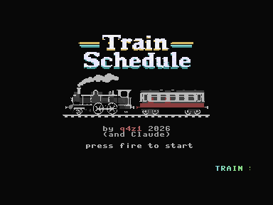
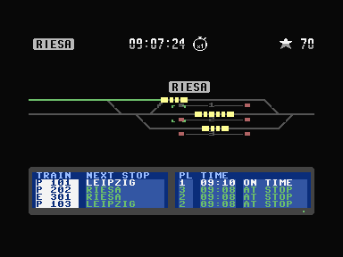
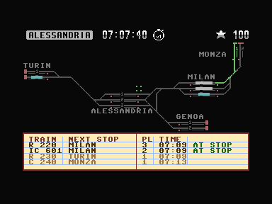
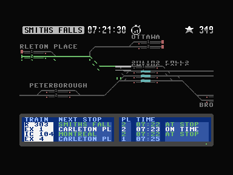
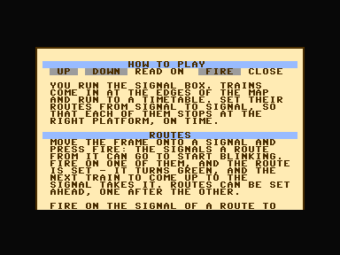
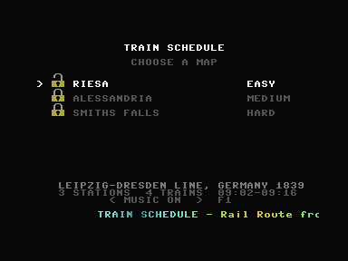
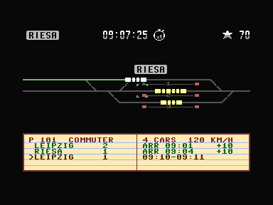
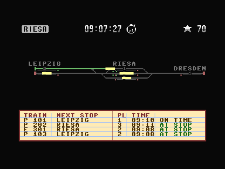
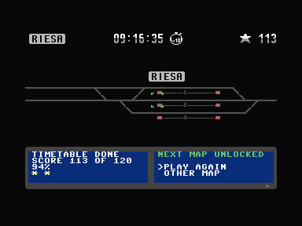

# trainschedule for the Commodore Plus/4

A signal box game: trains come in at the edges of the map and run to a
timetable, and you set their routes from signal to signal so that every
one of them stops at the right platform on time.

**Work in progress.** What is there: the timetable levels - a fixed track
layout, a timetable, routes set by the player, the score - opened one
after the other. Perhaps still to come, as far as memory allows: building
track and signals, and a game that goes on from day to day.



## After Rail Route

trainschedule is modelled on **[Rail Route](https://store.steampowered.com/app/1124180/Rail_Route/)**
by bitrich. The idea of the game, its rules and its numbers come from
there: the grid of track in eight directions, routes that run from a
signal to the next one facing the same way and are given back behind the
train, trains that speed up at 1 m/s² and brake at 1.61 m/s², and the
score of a timetable level - 10 for every stop, 2 less for every minute
late, 1 less for the wrong platform, 2 off for a train that has to stop at
a red signal and 1 for one that has to brake for it, and stars at 70, 90
and 100 per cent.

## The levels

### Riesa, 1839 - easy

The first level is set on the **Leipzig-Dresden railway**, Germany's first
long-distance line, opened between 1837 and 1839: Leipzig with two
platforms in the west, Riesa halfway with three, Dresden with one in the
east. Four trains run to the timetable from 09:00, twelve stops in all,
and three of them turn round at Riesa - a small station with a lot going
on at once, which is what makes it work. The line and the station names
are history; the track layout and the timetable are a game's.

It is a fan-made proof of concept, not affiliated with or endorsed by
bitrich. If you like this, play the real one.



### Alessandria - medium

The **industrial triangle** of northern Italy: Turin in the west, Genoa on
the coast in the south, Milan in the east and Monza just north of it, each
about where it is on a map, and **Alessandria** in the middle, where the
line from Turin meets the lines to Genoa and to Milan. Nine trains from
07:00, thirty stops, intercity and regional trains and a commuter train
between Monza and Milan.

What makes it harder than Riesa:

- **The junction.** At Alessandria the line from Turin comes in at the
  west end, and the lines to Milan and to Genoa leave at the east end - but
  platform 1 reaches only the Milan line, platform 3 only the Genoa line,
  and only platform 2 reaches both. A train put on the wrong one cannot
  go on the way it has to.
- **The chord.** East of Alessandria a line joins the Genoa line to the
  Milan line (in reality the line through Tortona), so a train from Genoa
  can run to Milan without Alessandria - and holds both lines as it does.
- **Single track.** Between the stations there is one track: trains meet
  only in the stations, and one sent out too soon blocks the one it meets.
- **Turning round.** Some trains turn round at Alessandria or Milan, one
  of them to go on to Genoa from the line it came in on.

Milan is a through station with three platforms; Turin, Genoa and Monza
are where the trains come from and go to, Monza's two platforms running
north towards Switzerland.



### Smiths Falls, 1887 - hard

The **Canadian Pacific** in eastern Ontario. Its line from Toronto to
Montreal, the Ontario and Quebec of 1884, crosses the old Brockville and
Ottawa at **Smiths Falls**: Toronto in the west, Peterborough on the way,
Montreal in the east; to the north-west Carleton Place, where the main
line goes on west to the Pacific, and north, from a junction on the way,
Ottawa; to the south Brockville on the St. Lawrence. The map is wider than
the screen - 64 cells - so even the overview scrolls. Fourteen trains from
07:00 to 07:40, fifty-six stops: intercity trains between Toronto and
Montreal, the transcontinental expresses, regional trains between Ottawa
and Brockville, a slow freight.

What makes it harder than Alessandria:

- **Two lines crossing.** At Smiths Falls only platforms 2 and 3 reach
  both the Toronto line and the Montreal line. Platform 1 has no way to
  Toronto, platform 4 leads only to Toronto and Brockville.
- **Double track, with a crossover.** Between Smiths Falls and Montreal
  there are two tracks. A crossover east of Smiths Falls joins the north
  one to the south one, and that is the way to Brockville from platforms 1
  and 2 - across the path of the trains coming in from Montreal.
- **A shared line north.** The lines to Carleton Place and to Ottawa join
  before Smiths Falls: one train at a time on either.
- **Turning round at Brockville.** The trains for Brockville turn there
  and come back through Smiths Falls: set a route from the signal behind
  the train. East of Brockville the line runs on to the ferry across the
  St. Lawrence - a train sent that way is gone.
- **Busy minutes.** Up to four trains at Smiths Falls at once, all four
  platforms taken, and trains leaving it minute after minute for Carleton
  Place, Brockville, Peterborough and Montreal.



## Playing

### Starting

`LOAD"*",8` and `RUN` (or `Shift`+`Run/Stop`) loads the first program on
the disk. The Radetzky March starts at once, the title picture comes a
few seconds later with "loading ..." below the credits while the game
loads behind it, and "press fire to start" when it is ready. Then a ticker
runs along the foot of the screen - what the game is, how it is played,
its controls - and on through the choice of a map without a break: each
map with how hard it is, a line about it and what it has - stations,
trains, the timetable's hours. Each map has its own music: Riesa plays
Zeuner's Rail Road Waltz, Alessandria the Allegro of Rossini's overture
to *Il barbiere di Siviglia*, Smiths Falls N.S. Smith's *C.P.R. Lancers*.
A train coming to a stand at its platform squeals on its brakes and lets
off steam; one leaving whistles and puffs away.
`F1` turns the music off, and on again, wherever the game is; with the
joystick it is left or right in the choice of a map, which shows which it
is.

**How to play.** A bulb glows at the top right of the choice of a map,
hopping now and then, until it has been read: up from the first map, then
fire - or the Plus/4's `Help` key - opens a page with how the game is
played and every key and joystick move. It is a small book like the board
in the game, longer than the screen: the stick scrolls it by the pixel,
faster the longer it is held, and lets it run out when let go. Fire closes
it, and the bulb stays dark from then on.



**Unlocking.** At first only Riesa is open. A star on a map - 70 per cent
of its points or more - opens the next one: the end of the level says so,
and the choice of a map has it chosen already. The lock beside each map
shows which are open. Until the Plus/4 is switched off.



### Controls

Everything works with a joystick of one button alone, in either port; the
keyboard has the same as keys. Fire counts when it is let go. Held, with a
direction pushed, it is a command instead, and the frame stays where it
is.

| | Joystick | Keyboard |
|---|---|---|
| Move the frame | stick | cursor keys |
| Choose, set, take back (see below) | fire | `Space` or `Return` |
| A train's timetable | fire on the train | |
| The next train's timetable; after the last, the board again | fire + down | `.` (`,` the one before) |
| Close a timetable | fire on an empty place | `Esc` |
| Close up / overview | fire + up | `Z` |
| Faster: pause, x1, x3, x10 | fire + right | `+` |
| Slower | fire + left | `-` |
| Title picture: on | fire | `Space` or `Return` |
| Choose a map | up / down, then fire | cursor keys, `Space` or `Return` |
| Music off / on | left / right in the choice of a map | `F1`, anywhere |
| How to play, all the keys | up to the bulb, fire | `Help`, in the choice of a map |
| Read on, close it | up / down; fire | cursor keys; `Space`, `Return`, `Esc` or `Help` |
| At the end: play again or another map | left / right, then fire | the same, or `L` for another |

A frame round a cell shows the cell fire acts on. A tap on the stick (or
a cursor key) moves it a cell; held, it goes on, faster the longer it is
held. Near the edge of the view, the view moves on by a third.

### Routes and trains

- **Setting a route.** Fire on a signal: the red lamps of the signals a
  route from it can go to start blinking (or the bar where a track leaves
  the map). Fire on one of them, and the route is set - its cells turn
  green, so does the signal. The first train to come up to the signal
  takes it. Routes can be set ahead, one after the other. When a train
  stops at a platform, the rest of the route it came in on goes grey; the
  routes set beyond it stay green until it has run over them.
- **Taking a route back, or changing it.** Fire on its signal: the route
  goes, together with any set after it, and the places it could go blink
  again - fire on one to set another, or anywhere else to leave it at
  that. This works for a route a train has taken too, as long as the train
  has not passed the signal and can still stop before it; it then brakes.
- **Turning a train round.** Set a route from the signal behind a train that
  stands at a platform: when it is due to leave, it leaves that way.
- **A train's timetable.** Fire on a train, or page through all of them with
  `,` and `.` - those still to come and those gone too. In place of the
  board: every stop with its platform and the times it is to arrive and
  leave, and for the stops made when it came and what that scored; `>`
  marks the stop it stands at or is on its way to. The train blinks on
  the map.



### What is on screen

On the map, every platform has its number in the middle: close up beside
the track in its edge, in the overview in the track itself. Close up, a
station's name is its station sign: dark letters on a light enamel plate,
in narrow lettering after DIN 1451.

At the top the map's name on a sign of its own, the clock and the score in
the tall digits of a split-flap board, between them the speed on the dial
of a stopwatch (two bars for the pause), and a star before the score - all
of it two rows high. At the bottom the board: a small book lying open, as
a station master's would have been when the maps' lines were built - cream
pages ruled in a pale blue, in a red cover that runs round them and down
the fold. The left page has the trains and the stop each is on its way to,
the right one its platform, when it is due there or leaves it, and whether
it is on time, in columns ruled like a ledger's. It is written in dark
brown ink; a train not yet in is faded, one at its stop green, one late
red. Four trains fit; with more, the list moves on a row every two seconds
and starts again from the top. What scored, and what to do next, blinks in
red over the head row for a few seconds. A train that whistles to set off
blinks till it is under way, and the board says DEPARTING meanwhile.





## Building

    ./build.sh

needs cc65's assembler and linker (with exomizer) and Python 3 with
Pillow, and makes
`build/trainschedule.d64`, the disk the game runs from (`run.sh` starts it
in VICE, `run-yape.sh` in Yape, with a gamepad set up as for Paradroid: its
left stick and A button are the joystick). On the disk:

| File | What |
|---|---|
| `trainschedule` | the boot program: puts the fast loader in place, shows the title picture and loads the game behind it |
| `game` | the game, packed by exomizer: it unpacks itself |
| `title.b`, `title.m` | the title picture, packed: the bitmap and its colours |
| `music` | the title's music: the Radetzky March |
| `maps` | the catalogue: each map's name and how hard it is, a line about it, its facts |
| `help` | the choice of a map and the page of help, packed: loaded before the choice |
| `map1`, `map2` ... | a map each: its music, its track and its timetable |

The maps are text, in [data/](data/), made into these files by
[tools/mklevel.py](tools/mklevel.py) along with the pixel tables the
characters are drawn from. So is the page of help,
[data/help.txt](data/help.txt), by [tools/mkhelp.py](tools/mkhelp.py),
with the bulb. The choice of a map and that page are an overlay
([help.s](help.s), part of [front.s](front.s)): outside a level the
memory of the map's song and the switches' bands is free, and the
overlay is loaded there - on the title already, while it says "loading",
with the fast loader. The title picture is a PNG,
[data/start.png](data/start.png), made into the TED's bitmap by
[tools/mkpicture.py](tools/mkpicture.py). The station signs' letters and
the flap digits are drawn, pixel by pixel, in
[tools/mkfont.py](tools/mkfont.py). The disk itself is written by
[tools/mkd64.py](tools/mkd64.py), with the files' sectors spaced for the
fast loader (below).

**Where the memory goes.** After a build,
[tools/memstat.py](tools/memstat.py) lists the RAM from $0000 to $FFFF:
who holds each range and what is still free, the program by module, the
largest tables and routines, how full each map leaves the buffers it is
loaded into, and the disk's files with their blocks.

```
python3 tools/memstat.py [--top N]
```

**The test build.** `tests/start.sh` builds the game and a second disk,
`build/trainschedule-test.d64`, with two bytes of the game set
([tools/patch.py](tools/patch.py)), and starts it: straight into a map,
or straight to the choice of one; the maps locked as in a new game, or
all of them open.

    tests/start.sh [MAP|choose] [locked|open] [yape|vice|plus4emu]

`tests/start.sh 2 open` is Alessandria at once, in Yape. In VS Code the
same is "Train Schedule: Testumgebung (Yape)" or "(VICE)" under F5, which
asks where to and how the locks are.

## How it works

**From the disk, fast.** The boot program asks the drive what it is (its
ROM at `$E5C5`). A 1541 of any kind, a 1570 or a 1571 gets a fast loader
written into it (drive.s, with M-W), and the Plus/4's half goes under the
ROM at `$FA00` (fastload.s), where the game finds it again for the title
picture and the maps. The drive still reads the disk through its own DOS
- a read job, as any program would ask for a sector - so it does not
depend on the drive's mechanics. Only the way the bytes come over is new:
one bit at a time on the DATA line, to each edge of CLK the Plus/4 makes.
The drive answers an edge within 14 µs, and the Plus/4 waits at least
29 µs before it looks - at the TED's fastest clock; an interrupt or the
TED's stolen cycles only make it wait longer. Between blocks and at the
end the two wait for each other, never for a time. This is how Siz's
[siziolib](https://github.com/iszell/siziolib) loads, after the G.I. Joe
loader; written anew here.

**The title picture first.** The boot program loads the title picture
before anything else and shows it, and loads the game behind it; the
game finds the picture up and leaves it there. So the picture is on the
screen a few seconds after `RUN` - 12 seconds after switching on, in VICE
and Yape, where it used to take 25 - and stays while the rest loads, with
"loading ..." below the credits; "press fire to start" when the game is
ready.

A sector takes 84 ms to come over with the screen off, and the DOS needs
some 50 ms after that before it can catch the next one - longer than the
ten sectors the DOS leaves between a file's sectors take to pass under
the head. So `mkd64.py` leaves fifteen (on the outer tracks, fewer on the
inner ones, the same time on all), and every sector is caught on the
first turn of the disk. The game itself loads with the picture on, when
the TED leaves the CPU a third less time; its sectors are a turn of the
disk less one apart, so it gets one sector a turn: 15 seconds for its 73
blocks, against nearly a minute by the KERNAL.

Any other drive - a 1551, a 1581, an SD2IEC - loads by the KERNAL, with the
screen off and the game's interrupt stopped, as in Stardew Pond. The
KERNAL needs 16 bytes at `$07D8` to load (found for Paradroid), where the
game keeps its routes: they are kept from the start and put back before
every load. The title picture is packed and unpacked by exomizer's
decruncher.

**The title** is two kinds of bitmap, one above the other. The lettering
at the top is multicolour - a cell of 4 x 8 pixels has the background,
one colour for the whole screen and two of its own, so the letters keep
their shadows. The train below is hires - two colours to a cell of 8 x
8, but every pixel - for its wheels and windows. A raster interrupt
switches from one to the other in a band of black lines between them, so
it needs no exact timing, and back in the vertical blank: the boot
program's while it loads, the game's after. Below the train the picture
is left black: the credits and the line below them are written into it
as text, in the ROM's characters, sharp as text is. `mkpicture.py` takes,
for every pixel of the TED's picture, the colour most of the source's
pixels under it are nearest to (so the source's soft edges do not turn
into colours of their own), measured the way the TED makes its colours,
in Y, U and V; then for every cell the colours that make it look best.

**The ticker** runs through two screens that have nothing else in
common: the title is a bitmap at `$C000`, the choice of a map is text. Its
strip is the bitmap's last row, `$DE00-$DF3F`; the choice of a map takes
its characters from `$D800` instead of `$C000`, and there those same 320
bytes are characters 192-231, which the choice's last row shows. So the
strip is never copied: the interrupt rolls it a pixel to the left every
picture, whichever screen is up, and the next glyph's column comes in at
the right from the ROM. Its colours are a wave from the logo's gold to
its blue and back, moving the other way: the cells' colours, rewritten
every picture (in the title the bitmap's two matrices, in the choice the
characters' colours - which is why the choice of a map has no
multicolour: half of these colours would make a cell multicolour there).
The choice is drawn on the second screen while
the title is still up, and in one vertical blank the TED is switched over
and the choice's other characters - the ROM's capitals and the locks - are
copied to `$D800`, over what was the title. The catalogue loads with the
title up, the fast loader not minding the interrupt; by the KERNAL the
screen goes off for it, and the ticker waits. The text is
[ticker.inc](ticker.inc): some 550 characters, a minute and a half.

**The map is cells, and the cells are the network.** A level comes as
lines of track between grid points, the way Rail Route keeps it. Loading
it, every cell gets a byte with a bit for each of the eight directions its
track leaves it in - and that is all the network there is. A switch is a
cell with three bits; a train may go on from a cell where the track bends
by 45 degrees at most, which in bits is: out by `b` when it came in by `a`,
if `b - a` is 3, 4 or 5 (mod 8). Searching for routes is walking these
bits, depth first, from a signal to the next ones (route.s).

**The characters are made from the bits.** Each bit is half a track, from
the middle of the cell to its edge - so a straight track, a bend, a switch
or a crossing is the half tracks put together, plus a signal's lamp, a
platform's edge or the end of the line. A level gets a character for each
combination it has, made when it loads. Lines are 2 pixels wide and placed
so that they run on into the next cell, the diagonals too. A switch in a
route shows the way it is set in the route's green, its other leg grey,
whole and in hires - multicolour would make the diagonals twice as
coarse. A hires character has one colour, though, and close up the legs
going up from a junction share their characters with the track across
it. So the TED is made to fetch a character row's colours a second time,
after its sixth line: the raster interrupt sets the vertical scroll so
that this line counts as a row's first, with the second colour written in
for it, and puts both back. The legs going up have one colour, the track
across the other, the legs going down the row below. A track up and down
beside a diagonal leg goes a pixel to the side, into the column of
characters the leg leaves free - and with it the whole of that track, end
to end, so that it stays one straight line, grey or green (worked out by
`tools/mklevel.py` as the map is built). Any other track up and down goes
a pixel to the left: in one column, it is two pixels wide in multicolour
too, and a platform's edge and number beside it keep their grey. A train
on such a track goes aside with it, its middle on the track's. In the
overview the same tracks go a pixel aside, for the same pair, and a
platform's number stands beside such a track rather than in it. In the overview a
cell is one character, and there is time for one fetch a row only, rows
of switches lying one under the other: it comes after the third line,
a leg going up grey above it, or green with the track across from there
multicolour - the way in the route's green, the rest grey, as fine as
hires along a straight line. A switch with a leg going down is
multicolour as a whole, that leg a little coarser in its three lines.
And as a platform's edge and number share their character with the
track there, a platform's cell in a route is multicolour too, the track
green and the edge grey. The TED holds the CPU in the
lines it fetches in, so the timing is tight: everything a row needs is
worked out beforehand, and a row the interrupt would reach too late is
left as it is for that picture rather than have the TED fetch at the
wrong moment. Only rows with such a switch in view get it - in Smiths
Falls, the busiest map, none in most pictures and rarely more than three
- at about 2 % of a picture each.

**The frame** round the cell pointed at follows a point the raster
interrupt moves every picture - however busy the game is, it never stops
or lags. The point goes a pixel at a time, faster the longer the stick is
held; let go, it goes to the middle of its cell, and a tap takes it from
there into the next. Close up, the corners lie in the last three lines
of a character, and where that character is hires they are drawn into
it in hires. Where it has little in those lines - nothing, a diagonal -
the same second fetch of colours as for the switches gives them the
route's green; where it has more - a sign, a platform's edge - the fetch
makes those three lines multicolour instead, what is there keeping its
own colour and the corners green over it. The cursor's
two rows have places of their own in the interrupt's list, in two sets
taking turns, filled as soon as the frame has moved: the frame is hires
from its first picture on, its corners green from the first or the
next. Elsewhere - in the overview, over a train - the
characters the corners are in switch to multicolour, as the cells under
a droid do in the Paradroid conversion: the map's character there
becomes multicolour (a pair of pixels with anything in it takes the
cell's own colour), so the track keeps its colour, and the corners are
drawn in the route's green, which all multicolour cells share. The rest
of the game writes to the view through one door (`vput`,
`vget` in engine.s): a character under a corner is not written but
becomes what lies under it, and the corner is drawn over it at once - so
nothing under it gets lost, and it is never off the screen for a
picture.

**Two sizes.** Close up, a cell is 2 x 2 characters, 16 x 16 pixels, drawn
from tables at that size. Each kind of cell is then four quarters, and a
quarter that looks like one already made is that character: a quarter only
shows three of the eight directions - the top right one north, north-east
and east - so a whole level needs few. Switching sizes makes the
characters afresh.

**Signs and flaps are characters two rows high.** A sign's letter and a
flap digit are 8 x 16 pixels: a character on top, one under it. Each
different half is one character, and only the halves the level needs get
one - the letters its station names have, the plate's two ends, the
digits, the star, the stopwatch: some fifty-five for Alessandria. The
stopwatch's lower half, where the speed is, is two characters of its own,
drawn afresh when the speed changes. They take the codes of the ROM's
characters no text uses (`←`, `(`, `;`, `?` and so on: thirteen) and the
rest from the top of the trains' characters, which end below them
(signs.s). The trains keep enough: close up, at Alessandria's busiest
moment, five of their characters are still free. Were there not enough
for a map's signs, its names would be the ROM's letters again; the digits
are always there. The plate is the character's colour, the letters are
the holes in it, so a sign needs no multicolour. The flap digits are
white above and grey below, with a line left out where the two flaps
meet.

**The board is in extended colour.** In that mode of the TED the top two
bits of a character's code choose its background, one of four, with only
the ROM's 64 characters. The map above needs all 256 characters and
multicolour, so a raster interrupt switches modes in row 18, the book's top
edge, and back in the vertical blank. That row has only plain characters
either way. Its background, black over the map, turns the paper in the
row's fifth line: the two lines over the cover stay black, a gap to the
tracks.

A cell has two colours only, its character's and its background - yet the
pages show paper, ink and the ruling's blue. The ruling is the background
too: the rows take turns between two registers of the paper's colour, and
an interrupt in each row sets that row's register to the blue for its last
line, the one under its letters, and back to the paper in the next row,
which is on the other register meanwhile. Only the write to the blue has to
be on time: in the right border of the line before, found by the beam's
place in its line ($FF1E). Written as the line count turns over, it came
three characters into the line - in plus4emu with a pixel of snow there -
and the ruled line is one where the TED stops the CPU to fetch the next
row's colours. Row 24's interrupt turns its register to the cover's colour
instead, two lines before the end: the book's lower edge. Should an
interrupt come too late, the line is left out for that picture rather than
drawn half (once in 4000 pictures of the busiest map at x10). The cover's
top, its sides, the fold and the columns' rules take seven of the ROM's
characters no text uses; the stations' signs keep the rest.
Characters in this mode cannot blink, so a message blinks by its colours.

**Trains move a pixel at a time, over a map that scrolls a cell at a
time** - a multicolour pixel, two wide, close up. Every character a train's
band touches is made anew from the map's character there and the band over
it: over the part of the half track it comes in by and the part of the half
it goes out by that it covers (engine.s, `eng_tcell`), worked out only at
the few bytes of a cell a track that way can touch. Only a train that has
moved on a pixel is drawn again, and all of it from its head, so that its
end and the gaps between its cars move with it. It takes its characters
from a free list and keeps those it is shown in till the new ones are on
screen: all trains' new ones go there at once, while the beam is below the
map, and then what they left behind goes back to the map's characters. So
a train is never off the screen for a moment, nor shown half moved on, and
it runs smoothly over switches and diagonals however the view lies. Close
up, the cars show: at every whole car's length behind the head a step of
the band is left out, and the grey track shows through the gap. Those
characters are multicolour, so what else lies in them - the leg of a
switch it passes - is two pixels a step: a diagonal three pixels wide
becomes two, a pair a line, rather than four (map.s, `grey_of`).

**A train knows its cells.** It keeps a ring of the cells it is on and the
cells of the routes it has taken, each with the way in and the way out.
Where to stop is worked out from the ring: before the next red signal, or
with its middle at the middle of the platform of its next stop. It brakes
when its braking distance (a table) reaches that point. A route taken back
is cut off the ring at its signal's cell - if that table says the train
can still stop before it.

**Time.** The game counts in 50ths of a second of its own time, taken from
the number of pictures shown, and steps all trains once per turn of its
loop by as many as have gone by - times x1, x3 or x10. A turn mostly takes
one picture: what costs more is spread out, the board written a
row a turn.

**All assembly.** The game began in C and is now all assembly, as
Paradroid is, to make room for what is still to come: the C was
rewritten module by module - the map, the routes, the trains, the title
and the disk, the game's loop (map.s, route.s, train.s, front.s,
trainschedule.s) - and checked against the C it replaced with the traces
of `tests/trace.py`, every second of a whole timetable the same in both.
The program went from 44 to 29 KB in memory, 15 KB more room, and from
78 to 61 blocks on the disk. Two things are done differently where it
does not show: a train turning round is turned round where it is in its
ring, without a copy of it; and a train coming in so close to its stop
that it cannot even crawl in comes in standing - the C read past the end
of its braking table there.

**Music.** The title and the choice of a map play Johann Strauss I's
*Radetzky March* (1848): the march without its trio, 52 bars, a minim =
104, looping. The tune as Strauss wrote it (the notes after the flute
edition at [flutetunes.com](https://www.flutetunes.com/tunes.php?id=364)),
the grace notes a picture each; under it, on the TED's second voice, a
march's oom-pah - the bass on the beat, a note of the chord after it. A
map brings its own, as loud as the march. Riesa plays Charles Zeuner's *Rail Road
Waltz* "for the piano forte" (Boston: Oliver Ditson, 1835, from the scan
the Library of Congress keeps): the waltz without its trio, as its repeats
go - A A B A B A, 48 bars - with an oom-pah-pah from his left hand's
chords. Alessandria plays the Allegro con brio of Gioachino Rossini's
overture to *Il barbiere di Siviglia* (1816), a crotchet = 150: the first
theme in E minor with the cellos' answer, a run down onto D, and the
crescendo in G major to its cadence, which leads into the theme again as
it does in the overture - 65 bars, 104 seconds. The violins on voice 1,
the cellos and basses on voice 2 (the notes taken from an orchestral MIDI
file at [classicalmidi.co.uk](http://www.classicalmidi.co.uk/rossini.htm)).
Smiths Falls plays the first figure of *The C.P.R. Lancers* for piano by
N.S. Smith, a Canadian composer (Toronto: I. Suckling & Sons, 1887,
dedicated to Sir George Stephen, the railway's president; from the scan
[Library and Archives Canada](https://www.collectionscanada.gc.ca/obj/028008/f2/csm6896.pdf)
keeps): its 6/8 fanfare in B flat to the Fine, the answer, the 2/4 part in
E flat, and round again as its D.C. goes - 24 bars, a dotted crotchet 24
pictures. The fanfare in octaves on both voices, then an oom-pah from the
left hand's bass and chords, the bass an octave up where the TED cannot go
so low.

All are text, [data/music.txt](data/music.txt), made into what the
player reads by [tools/mkmusic.py](tools/mkmusic.py): notes and lengths in 50ths
of a second, staccato marked; whatever comes more than once is a pattern,
put once and played from wherever it is needed - mkmusic.py finds them
itself (the Barbiere 30 % smaller for it, the march 19 %); each song has its own
small table of the TED's frequencies, of just the notes it uses. The
player (music.inc) runs once a picture on the raster interrupt, so the
tempo never depends on how busy anything is. The march is a file of its
own, `music`, at `$E800`: the boot program loads it first and starts it
at once, before the picture, and plays it while the rest loads and the
game unpacks itself; the game's interrupt goes on with it where it is
(it copies the boot program's place). In a level that memory belongs to
the route search, so the march stops there and comes from the disk again
for the next choice of a map. A map's song is part of its file, before
the map itself: the game loads the file to where the trains' rings will
be and puts the song at `$B000`, the map where the level is built from.
A new map names its song in its text (`music NAME`). To hear a song
without the game, [tools/song2wav.py](tools/song2wav.py) plays it into a
`.wav` as the player would. Voice 2 is
the accompaniment's only till a sound effect wants it (eng_sfx in
engine.s): it then stays silent, keeping time, and comes back with its
next note when the effect is over - as in Stardew Pond. `F1` is read
with the rest of the keyboard on the interrupt, so it works on every
screen: off, the player waits where it is and both voices fall silent; on,
it goes on from there. Sound effects are heard either way.

**Sound effects.** The TED has no envelopes and no filter, and one volume
for both voices, so an effect is a list of steps instead (`sfx_arrive`,
`sfx_leave` in engine.s): pictures, a frequency, square, noise or a rest,
one step a picture at most, played on the same interrupt. A train in at
its platform: a squeal wavering down from 1.8 kHz, a moment's quiet, then
noise growing darker and stuttering out - the steam let off, dying away
without a volume to turn down. A train away: the whistle, A and C sharp a
picture each, so that it sounds as the two notes at once; then five puffs
of noise, bright to dark, closer and closer. It whistles when it moves,
not when its dwell is over, so a train held at a red signal stays quiet
till it goes. One effect at a time: one that comes while another plays is
not heard.

## Testing

`tests/shot.py` runs the game in a VICE without a window and prints the
screen as text. Where the time goes: `tests/loopprof.py` times the game's
loop turn by turn - how many pictures a turn takes, and the calls in it -
`tests/fprof.py` one call instruction by instruction, `tests/drawcost.py`
what drawing the trains costs. `tests/yape_smooth.py` saves pictures in a
row in Yape and measures how far each train moves from one to the next:
how smoothly they run. `tests/loadtime.py` measures how long the disk takes.
`tests/p4emu_check.py` boots the disk in plus4emu, which emulates the
1541 down to its mechanics: from `RUN` the music comes after 2.8 seconds,
the picture after 5, the game is ready after 25. `tests/screenshots.py`
makes this README's pictures there anew. An autopilot (`autopilot_on` in
train.s) sets routes the way a player would, for the tests: only to the
platform in the timetable (another may lead nowhere the train has to go
on to), and a route on from a stop not until shortly before the train may
leave (sooner, it would hold up the trains the timetable has come first).
It plays Riesa to 113 of 120 points, Alessandria to 296 of 300 and Smiths
Falls to 544 of 560, every stop on time: proof that the timetables can be
kept.

`tests/trace.py` plays a map from start to end with the game's time
counted, not waited for (`_dbg_n`), so that a run comes out the same every
time: the autopilot alone, or (`play`) with a player choosing signals and
where their routes go, taking routes back, switching sizes, paging through
the timetables and scrolling the view, at random but seeded. Every second
of the game it saves the memory; `tests/tracecmp.py` compares two such
runs - the map, its characters, the routes, the trains, the score, the
screen - and says where they first differ. `tests/rendercmp.py` compares
what the view shows, each cell's glyph and colour, for two builds that
hand out the trains' characters differently.

How this was made: see the [main README](../README.md#how-this-was-made).
