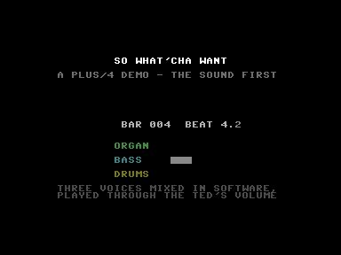

# So What'cha Want - a Plus/4 demo

A demo for the Commodore Plus/4 to **So What'cha Want** (Beastie Boys,
1992). The sound comes first; the pictures will be fitted to it once it
stands.

**Work in progress.** What is there: the player - three voices mixed in
software and played through the TED's volume register (International
Karate's mixer, as Simple Soccer's title has it), grown for a Hammond
organ: waves built from the nine drawbars, the percussion's click at a
note's start, a Leslie's vibrato and tremolo - and a first take of the
music. That take was guessed from the record's notes and is not
recognisable; the next one is built on samples of the record itself,
cut by hand (see below), with the organ played by the player on top.



The screen shows where the music is - bar, beat, sixteenth - and each
voice's level: what the pictures will be timed by.

## Building and running

```sh
./build.sh            # build/whatchawant.prg
./build.sh --wav      # and build/music.wav: the music as the TED plays it
python3 tests/music.py [seconds]   # in Yape: build/music-yape.mp4, .wav
```

The music is written in `data/music.txt` (its format is explained at its
top); `tools/mkmusic.py` makes the player's data of it.

## Preparing the samples (Audacity)

The record is in `ref/` (not in git). What the Plus/4 can play: 5542
samples a second, 9 levels - so anything above about 2.7 kHz comes back
as a chirp, and anything quiet drowns in the steps. Cut and treat each
piece so, and the noise goes down a lot.

Audacity is the editor (Audacious is only a player):
`flatpak install flathub org.audacityteam.Audacity`

**The record's grid.** 85.38 beats a minute, steady all through: a bar is
**2.811 s**, two bars 5.622 s. Bar *n* starts at 0.459 s + *n* x 2.811 s:

| Part | Bars | Starts at |
| --- | --- | --- |
| intro | 0-2 | 0:00.459 |
| main loop (with vocals) | 3-42 | 0:08.892 |
| second part, round A | 43-49 | 2:01.330 |
| break | 50-51 | 2:21.007 |
| main loop again | 52-76 | 2:26.629 |
| **cleanest main loop** (almost no vocals) | **70-71** | **3:17.226** |
| also clean | 74-75 | 3:28.470 |

(Where bar 1 really falls is not certain: it may be an eighth, 0.351 s,
off. Trust your ear and cut on the downbeat you hear.)

**Each piece:**

1. *File > Import > Audio*: the MP3.
2. *Tracks > Mix > Mix Stereo Down to Mono*.
3. Select the piece: in the *Selection* toolbar at the bottom set the
   format to *hh:mm:ss + milliseconds*, type the start, and as its
   length exactly 2.811 s (one bar) or 5.622 s (two). Play it looped
   (*L* switches looping on, Audacity 3.2 on; older ones: *Shift+Space*)
   and nudge the start until it loops without a hiccup.
4. *Edit > Remove Special > Trim Audio*: only the piece is left.
5. *Effect > EQ and Filters > Low-Pass Filter*: 2500 Hz, 48 dB per
   octave. (Hi-hats mostly go with it - that is right, the Plus/4 cannot
   play them anyway; the player's own noise can add them back.)
6. *Effect > Volume and Compression > Compressor*: threshold about
   -20 dB, ratio 4:1 or more, *make-up gain* on. Few levels want a
   loud, even signal.
7. *Effect > Volume and Compression > Normalize*: -1 dB.
8. *File > Export Audio*: WAV, 16-bit, mono, any rate (it is brought to
   5542 Hz here).

**What to deliver,** into `ref/`, one file a piece:

| File | What |
| --- | --- |
| `main.wav` | the main loop, drums and bass, 1 or 2 bars |
| `b.wav` | the second part's loop |
| `intro.wav`, `break.wav` | if you want them as they are |
| `organ-*.wav` | the organ alone, if you can get it clean - else the player plays it |
| `ohyeah.wav` | the "Oh yeah", cut tight, no silence before or after |

A sample costs about 2.7 KB a second of memory (two samples to a byte),
some 7.6 KB a bar, so whole bars as loops are cheap; the demo puts the
song together of them.

## How this was made

Directed by the author, with an AI coding assistant used intensively for
the implementation - see the main README.
